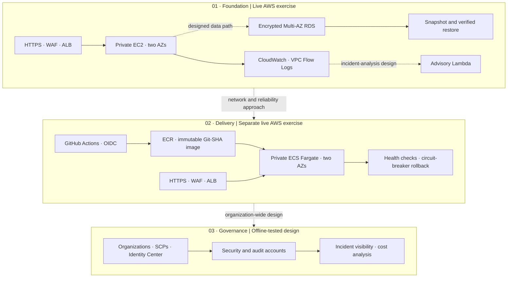

# RSVP Cloud Platform

**One cloud engineering portfolio, built from a real business decision.**

I built [RSVP Society](https://github.com/JNHolman/rsvp-society) to manage private events: membership approvals, invitation waves, text-message RSVPs, guest limits, and check-in. Building that application forced me to make a decision I encounter in infrastructure engineering: **what does the business actually need, and what is unnecessary complexity?**

## Why the architecture changed

My first AWS design used familiar enterprise components: a VPC, an Application Load Balancer, EC2 servers, and a relational database. It was a reasonable model for a service with steady demand. But RSVP Society gets busy around invitations and event days, not around the clock.

I chose a serverless design for RSVP Society so the infrastructure matched that pattern.

| Responsibility | Original enterprise design | RSVP Society's approach | Why it fits |
| --- | --- | --- | --- |
| Application requests | Load balancer and always-on EC2 | API Gateway and Lambda | Run code when requests arrive |
| Application data | Provisioned RDS database | DynamoDB | Scale database capacity with event activity |
| Website delivery | Web server behind the load balancer | CloudFront | Deliver and cache the frontend without an application server |
| Invitations and reminders | Server-managed background scheduling | EventBridge Scheduler | Trigger tasks when they're due |

The original model didn't fit the business, but it gave me an opportunity to develop the infrastructure work further. I used it as the starting point for this separate cloud engineering portfolio.

## One platform, three connected parts

| Part | Engineering focus | Question it answers |
| --- | --- | --- |
| [**01 · Cloud Foundation**](project-1-cloud-foundation/README.md) | Private networking, EC2, encrypted RDS, WAF, monitoring and recovery | Can I make a traditional application secure, observable, and recoverable? |
| [**02 · ECS & CI/CD**](project-2-ecs-cicd/README.md) | Private Fargate services, GitHub Actions, OIDC, ECR and deployment rollback | Can I ship software changes without losing control of the running service? |
| [**03 · Cloud Governance**](project-3-cloud-governance/README.md) | Organization guardrails, identity, centralized security, logging and costs | How would those standards be applied across teams and accounts? |

The three parts build on the same principles: establish secure infrastructure, deliver changes safely, and extend controls across accounts. The EC2 and ECS exercises were tested independently; governance was validated locally.

## What I actually demonstrated

### Foundation — private infrastructure and database recovery

The November 8, 2026 exercise verified private EC2 targets across two Availability Zones, working HTTPS, WAF blocking, and CloudWatch alarm transitions. I restored an encrypted RDS snapshot to a separate database and read back a known record over TLS in **10 minutes 2 seconds**.

[Technical decisions and code](project-1-cloud-foundation/README.md) · [Test evidence](project-1-cloud-foundation/evidence/2026-11-08.md)

### Delivery — identifiable releases and tested rollback

GitHub Actions deployed an identifiable container image to private ECS tasks using temporary AWS credentials. A deliberately broken revision triggered ECS to restore the previous healthy version in **13 minutes 47 seconds**. A later image rebuild reduced ECR HIGH vulnerability findings from nine to two.

[Technical decisions and code](project-2-ecs-cicd/README.md) · [Release evidence](project-2-ecs-cicd/evidence/2026-11-08.md) · [GitHub Actions run](https://github.com/JNHolman/RSVP-Cloud-Platform/actions/runs/42458363871)

### Governance — security guardrails designed and tested locally

The six-account design separates management, security, audit, shared services, and nonproduction/production responsibilities. Its **service control policies (SCPs)** define restrictions on leaving the organization and disabling core security services.

**Verified:** Terraform policy tests checked deny rules and explicit administrator exceptions, including rejection of wildcard patterns. Python tests checked security and cost-analysis logic. The [governance CI job](https://github.com/JNHolman/RSVP-Cloud-Platform/actions/runs/42513576400/job/128831638392) passed.

[Governance implementation, test results, and engineering trade-off](project-3-cloud-governance/README.md)

## Engineering approach

My enterprise network engineering background shaped the platform: keep traffic paths explicit, separate infrastructure changes from application releases, and verify recovery instead of relying on configuration alone. The original RSVP Society decision remains the standard—build what the workload actually needs.

[Resource ownership, production safeguards, and recovery custody](shared/OPERATIONS.md)

**Josh Holman** · Network / Cloud Infrastructure Engineer
