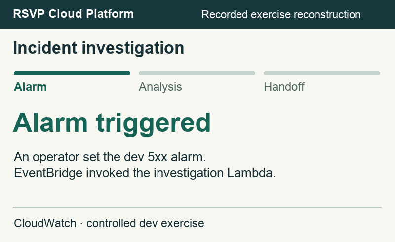

# RSVP Cloud Platform

RSVP Cloud Platform wasn't something I originally planned as a portfolio project. It started when I used my event business as a reason to learn AWS. What began as a way to build something useful became a bigger engineering challenge. My background in network engineering kept pulling me toward the questions that matter when something goes wrong: What failed? How do I know a change worked? How do I recover when it doesn't? That curiosity led me into cloud infrastructure, deployment automation, security and AI. The three projects here follow that progression.

## Where this came from

I run [RSVP Society](https://github.com/JNHolman/rsvp-society), a private-event business. Invitations, guest questions, replies and attendance used to involve a lot of coordination by text. When I started learning AWS, that gave me a real problem to build around.

My first approach was a three-tier system: a public load balancer, private application servers and a relational database. I kept adding the infrastructure I was learning. It taught me plenty, but the more I looked at what the business actually needed, the more it felt like I was building a Mack truck behind a website.

I moved RSVP Society to a lighter serverless design. Jade helps with routine guest conversations, while the application still controls invitations and business rules. I kept the original AWS work as a separate lab, where I could test the infrastructure without making the business pay to keep it running.

That shift gave the project a different purpose. I wanted to go beyond getting a website online and work through questions I'd faced in network operations: **Can I prove which service is responding, trace what failed, recover usable data and keep automated decisions under control?**

## What happened when I tested it

These were controlled AWS exercises using a test reservation application, sample alerts and deliberately introduced failures—not production guest traffic or live security incidents. I measured what happened and checked the result rather than relying only on an AWS status indicator.

| Exercise | Recorded result | What I verified |
|---|---|---|
| [Private application connectivity](project-1-cloud-foundation/README.md#live-integration-on-november-8) | EC2 and ECS endpoints returned the same **three test reservation records** | Two applications in different private networks could read the same database |
| [AI incident investigation](project-1-cloud-foundation/README.md#ai-incident-analysis) | A manually triggered alarm led to analysis of **77 log entries**, a saved encrypted report and a test notification | The evidence-and-notification path worked; the model did not establish the startup root cause |
| [Wrong-version deployment](project-2-ecs-cicd/README.md#live-integrated-release-on-november-8) | Previous version verified in **3m 23s** | A responding container could still serve the wrong release, and the workflow caught it |
| [Unhealthy ECS deployment](project-2-ecs-cicd/README.md#two-ways-to-reject-a-release) | Previous working revision restored in **13m 47s** | ECS rejected a deployment whose containers would not stabilize |
| [Encrypted database restore](project-1-cloud-foundation/README.md#recovery-evidence) | Expected test row read in **10m 02s** | The restored database contained usable data; application cutover was not tested |
| [Multi-AZ RDS failover](project-1-cloud-foundation/README.md#recovery-evidence) | Database operation completed in **19.85s** | An RDS operation interval—not the time for clients to recover |
| [Capacity under load](project-2-ecs-cicd/README.md#capacity-under-load) | Running ECS tasks increased from **2 to 3** during 1,625 requests | Scale-out happened; a full scale-in cycle was not observed |
| [AI security-priority decision](project-3-cloud-governance/README.md#live-aws-exercise) | AI suggested **P3**; a fixed policy enforced **P1** | A sampled critical alert retained its required priority despite the model's advice |

Those measurements have different starting points and should not be compared as one recovery benchmark. The newer database-aware release checks were tested with simulated workflow responses after the AWS runtime was retired. The six-account governance design and its policy checks were validated offline, not deployed as an organization. [Security and infrastructure review](shared/checkov-review.md).

*25-second reconstruction from recorded AWS exercise results, not a live recording. The project links above lead to the underlying evidence.*

## What problems am I working through?

My networking background shapes these decisions. A permitted route doesn't prove an application can read its database; a healthy container doesn't prove the correct version reached users. I approached the AWS work by separating those failure conditions.

| Engineering problem | Approach | Why it matters |
|---|---|---|
| Users need an application without exposing its servers or database | Protected HTTPS entry points, private networks, restricted routes and security groups | Separates public access from internal services |
| Infrastructure can drift or be changed without a clear record | Terraform, separate state and deliberate application of changes | Makes the intended configuration reviewable and keeps the business environment distinct |
| Deployments need identity, traceability and a way back | GitHub Actions, temporary AWS credentials, immutable Git-revision images and external checks | Proves which version is serving instead of trusting container health alone |
| Incidents start with incomplete and sometimes sensitive evidence | CloudWatch, time-bounded log collection, redaction, AI assessment and durable reports | Gives an engineer useful evidence without giving AI permission to repair anything |
| Backups and availability settings are not the same as recovery | Multi-AZ database design, snapshot and point-in-time restores, and reads of known data | Verifies what can be recovered and what still needs testing |
| Security advice and authorization must remain separate | Offline governance policies and a separately tested AI severity rule | Limits who can change the environment and prevents a model from silently lowering an alert's priority |

## How the three projects fit together

**[1. Cloud Foundation](project-1-cloud-foundation/README.md)** establishes the private network, application and database that the rest of the lab depends on. It focuses on proving the full request path, investigating alarms and restoring usable data.

**[2. ECS & CI/CD](project-2-ecs-cicd/README.md)** moves the **same reservation application** into containers on a separate VPC while continuing to use Project 1's database. It focuses on which software is actually serving and what happens when a release goes wrong.

**[3. Cloud Governance](project-3-cloud-governance/README.md)** examines who should control changes, security reviews and audit records as that environment grows. Its six-account design was checked offline; the AI security-priority exercise was tested separately in an existing AWS account.

## The platform in plain English

~~~mermaid
flowchart TB
    visitor["Test browser"] --> edge["Foundation HTTPS entry point + WAF"]
    visitor --> edge2["Delivery HTTPS entry point + WAF"]
    edge --> ec2["Private EC2 application · Foundation"]
    edge2 --> ecs["Private ECS containers · Delivery"]
    ec2 --> db[("Shared private RDS database")]
    ecs -->|"Private VPC peering + scoped reader access"| db
    actions["GitHub Actions · tests, image scans and releases"] --> ecs
    ec2 --> logs["CloudWatch logs + alarms"]
    logs --> investigation["Bounded AI incident analysis"]
    investigation --> evidence["Stored report + encrypted test-subscriber notification"]
    governance["Six-account governance blueprint · offline tests"] -. "Proposed separation, not deployed enforcement" .-> ecs
    sample["Sample critical security alert"] --> triage["AI recommendation + fixed priority rule"]
    triage --> security["P1 decision saved + test notification"]
~~~

Two HTTPS entry points lead to a shared private database: one through virtual servers (EC2), the other through managed containers (ECS) in a separate network. Terraform defines the infrastructure; GitHub Actions releases container versions. The dotted governance connection shows **design intent**, not controls deployed over the application. The critical-alert exercise ran separately.

## Where automation earns its place

The AI work here isn't just asking a model a question. It's making the evidence limited, the answer verifiable and the failure path predictable so an engineer can use the result without handing over control.

For incident analysis, a Python function gathers CloudWatch logs near an alarm, limits the sample to **120 entries**, derives HTTP status counts and connection-refusal counts, and sends those signals with the alarm category and collection status to the model. It validates the returned fields and confidence before storing the assessment. If collection or model analysis fails, the report keeps the known alarm evidence and marks the uncertainty instead of inventing a diagnosis. An engineer still determines the cause and owns any fix. [Incident handler](project-1-cloud-foundation/terraform/ai_log_summarizer.py)

For security triage, AI may suggest a priority, but a fixed severity rule takes precedence. The live sample produced a **P3 recommendation and P1 enforced decision**; both were recorded so an investigator could see why the model's suggestion was not followed. In a later AWS exercise, two controlled fallbacks triggered a CloudWatch alarm that reached the encrypted test subscriber. [Live alarm receipt](project-3-cloud-governance/evidence/live-finding-lifecycle.json). [Decision logic](project-3-cloud-governance/security-admin/ai_incident_analyzer.py)

For delivery, automation checks the exact Git revision served by the HTTPS endpoint. It doesn't assume that a green container-health check proves the right software is deployed. Terraform manages the infrastructure baseline; GitHub Actions manages application releases. [Deployment workflow](.github/workflows/ecs-project2-deploy.yml)

I also built an AI-assisted cost analyzer, but the shared AWS account lacked allocation tags to reliably separate lab spending from RSVP Society. I could not substantiate platform-only savings, so I don't claim any. [Cost analysis implementation](project-3-cloud-governance/finops-ai/cost_analyzer.py)

## The decisions behind the architecture

The business migration taught me that a sound design is not the one with the most components. I used extra infrastructure in this lab when it gave me something meaningful to test, but I didn't assume every control belonged in the production event business.

| Decision | Why I made it | What it cost or didn't prove |
|---|---|---|
| **Keep RSVP Society serverless; retain three-tier AWS as a lab** | The business needed less overhead, while I needed somewhere to test operations and failure handling | The lab is not the business's production architecture |
| **Public HTTPS entry point with private applications and database** | Keep users on the intended route without exposing application servers or data directly | Additional routing, firewall and access-control complexity |
| **One NAT gateway per Availability Zone** | Avoid depending on one zone for private outbound traffic | More baseline cost than a single shared gateway |
| **Multi-AZ RDS** | Test database redundancy and failover | Higher running cost; the **19.85s database operation** did not measure full application recovery |
| **ECS Fargate over Kubernetes** | Concentrate on release reliability, networking and scale without managing a cluster | Less control over container hosts |
| **GitHub OIDC instead of permanent deployment keys** | Limit the lifetime and scope of deployment credentials | GitHub restricts lab `prod` to the PR-protected `main` branch. Both release workflows check CI for the selected commit. A human reviewer is optional |
| **Immutable Git-revision images and a separate release pipeline** | Verify what actually reached the service and prevent Terraform from silently reverting an application version | Image lifecycle and explicit handoff when task definitions change |
| **Bounded AI analysis, with fixed rules and human ownership** | Use models to summarize evidence without letting them silently authorize changes or reduce critical severity | Model conclusions are provisional, and failure handling must be tested |
| **Six-account governance design without six deployed accounts** | Study separation of duties without incurring unjustified setup and operating costs | Offline policy tests do not prove live cross-account enforcement |
| **Single AWS Region and short-lived lab environments** | Make failure exercises financially sustainable | No whole-region recovery or sustained production-capacity demonstration |

### A network engineer's view of cloud

The techniques are familiar from incident bridges: follow the traffic, separate reachability from application behavior, identify the dependency and verify the result after a change. In AWS, that meant checking **both directions of VPC routing**, the database's security boundary and the application's ability to read a known record. For releases, it meant checking the version actually returned over HTTPS. For recovery, it meant querying restored data rather than ending at a green console status.

### Cost is an engineering constraint, not an afterthought

I shut down the application runtime after the exercises and initially kept the encrypted recovery assets so the restores could be inspected. At final retirement on November 11, I removed the lab snapshots, retained automated backups, backup vault, registries, evidence buckets, and dedicated Terraform backend. I verified the original incident report against its published digest before removing its AWS copy. The lab keys entered their deletion windows, and the child DNS zone was removed after its parent delegation was withdrawn.

## What this work proves—and what it doesn't

What connects these exercises is the operating discipline I brought from network engineering: understand the dependency, test the actual service, keep changes traceable and check the result after failure. In cloud and AI work, that also means knowing which decisions automation can make and which still need a person or fixed policy.

This was a short-lived engineering lab, not a continuously operated enterprise service. The alarm was triggered manually; database operation times aren't complete application recovery times; the newer database-aware release checks used simulated responses; and the multi-account governance design wasn't deployed. Each project README documents its evidence and limitations. The value is in what I could test, explain and reproduce—not claiming that the lab was production.

---

**Josh Holman** — Network / Cloud Infrastructure Engineer
