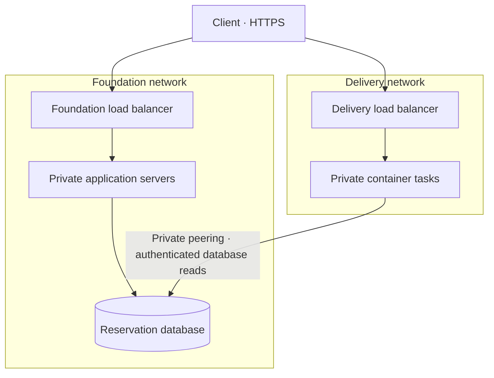

# RSVP Cloud Platform

When RSVP Society sends a wave of invitations, guests reply, change plans and bring friends. Between events there may be very little work for the application to do. My first AWS design kept application servers and a highly available database running throughout those quiet periods. For the business, it made more sense to pay for work as requests arrived. I moved the production application toward event-driven services. [RSVP Society and its event operations](https://github.com/JNHolman/rsvp-society)

I kept the original design to answer a different question from my work in network operations: when a customer request fails, can I follow it from the public entry point to the database, find what broke, and prove that service has recovered? **RSVP Cloud Platform is the environment I built to test that question.** I ran the same read-only application on virtual machines and containers, deliberately introduced failures, and kept the results after retiring the temporary infrastructure.

## One application, two ways to serve it

Both paths could return the same reservation. That gave me a concrete way to test a network route, a software release and a restored database: could the application still read the expected data? The governance layer extends that work to the people and policies responsible for investigating problems. Its live exercise tested who gets the final say when an AI recommendation conflicts with security policy.

## What I built and verified

**1 · Cloud Foundation.** Behind the web application firewall and load balancer, application servers in two AWS Availability Zones read from an encrypted relational database. During a controlled alarm exercise, the incident pipeline collected **77 log entries**. The model identified refused backend connections, traced the return of healthy responses, and recommended checks. The system saved the report and delivered a notification. Remediation stayed with the operator. A separate encrypted snapshot restore returned a known database row in **10m 02s**. [Infrastructure, AI report and recovery evidence](project-1-cloud-foundation/README.md)

**2 · Software Delivery.** I released the same application to private containers and verified that both versions read the same database rows over encrypted connections. A deliberately incorrect release answered health checks but served the wrong version. GitHub Actions detected the mismatch and verified the previous release in **3m 23s**. In a separate failure, the ECS circuit breaker recovered an unhealthy revision in **13m 47s**. Under load, the service grew from two running tasks to three. [Release records and scaling chart](project-2-ecs-cicd/README.md)

**3 · Cloud Governance.** In a single AWS account, a labeled sample critical finding triggered an AI investigation. The model proposed **P3** because it recognized a rehearsal. The severity policy enforced **P1**, and the system stored the decision and delivered the alert. AWS also validated the two generated service control policy documents. The six-account design and its trust boundaries have offline coverage. Live enforcement across accounts remains unverified. [Investigation, policy results and design limits](project-3-cloud-governance/README.md)

## Engineering Decisions and Trade-offs

**Production isolation.** The lab shared an AWS account with Society. Dedicated resource names, Terraform state keys and a delegated DNS zone under `cloud.rsvpsociety.com` bounded the exercise. Reviewed plans excluded Society’s database, IAM identities and production DNS. An older development resource with unclear ownership was left alone.

**Release ownership.** Foundation owned the database and private network. Delivery owned the peering connection, return routes and reader permissions. Separate state let me retire the consumer first. Terraform managed the infrastructure baseline, while GitHub Actions promoted application revisions. In the governance design, AWS Config aggregation covers accounts only where Config recording is enabled.

**Recovery and cost.** Terraform retired 80 foundation resources, 60 ECS runtime resources and two temporary delivery resources. Release task definitions 6 and 7 remained registered after service retirement. The final RDS snapshot was available and encrypted. RDS recovery points inherit the database encryption key. Project 1 recovery KMS keys have intentional Terraform destruction guards, so I do not expect an unrestricted `terraform destroy` to remove them alongside the runtime.

The encrypted snapshots, completed AWS Backup recovery point, log buckets and incident index were retained. Keys and storage can continue to incur charges. No cost-allocation tags were active during the exercise, so the portfolio’s share of the bill could not be established.

The infrastructure scan is advisory. The review covers IAM scope, reachability, encryption and monitoring across the three layers. [Disposition of the 42 Checkov findings](shared/checkov-review.md)

**Josh Holman** — Network / Cloud Infrastructure Engineer
