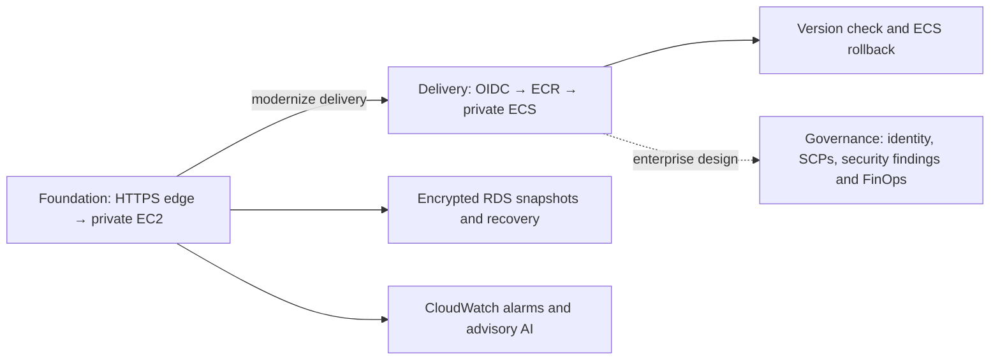

# RSVP Cloud Platform

**An AWS engineering portfolio built from a real business decision.**

I originally designed traditional AWS infrastructure for [RSVP Society](https://github.com/JNHolman/rsvp-society), my event-management platform. It worked as an architecture, but it was too expensive for a business with traffic concentrated around invitations and events.

I moved RSVP Society to event-driven services—Lambda, API Gateway, DynamoDB, and EventBridge—and kept the original enterprise infrastructure work as a separate engineering project.

My network engineering background shaped the exercises. I wanted to trace a failed request across the network, identify which release was serving traffic, and prove that a recovered database could answer an application query.

## Three stages

| Stage | Engineering focus | What it demonstrates |
| --- | --- | --- |
| [Cloud Foundation](project-1-cloud-foundation/README.md) | Private EC2, ALB/WAF, Multi-AZ RDS, monitoring, backups | Secure networking, availability, recovery, incident analysis |
| [ECS & CI/CD](project-2-ecs-cicd/README.md) | ECS Fargate, ECR, GitHub OIDC, CI/CD | Immutable releases, private containers, health checks, rollback |
| [Cloud Governance](project-3-cloud-governance/README.md) | Organizations, SCPs, identity, audit logging, security and cost analysis | Live incident triage and SCP document validation |

Foundation establishes the network, recovery and monitoring boundaries. Delivery carries those requirements into the container release process. Governance models how an organization could enforce them across accounts. The integrated dev exercise served the same Flask application from private EC2 and ECS. Both HTTPS paths read the same operator-inserted row from private RDS using IAM authentication and verified TLS.

## What I verified

- **Project 1:** Two private application targets across two Availability Zones, HTTPS, WAF blocking, monitoring, and an encrypted RDS snapshot restore. **Measured restore: 10m 02s.**
- **Project 2:** GitHub OIDC delivery to private ECS tasks and a deliberately failed release recovered by the ECS circuit breaker. **Measured rollback: 13m 47s.**
- **Project 3:** AWS validated both SCP documents. A sample critical finding triggered AI triage, priority enforcement and notification in AWS. Organization-wide enforcement has not been tested live.

These are dated test results, not claims that every integration is currently deployed. See the [Project 1](project-1-cloud-foundation/evidence/2026-11-08.md) and [Project 2](project-2-ecs-cicd/evidence/2026-11-08.md) reports.

The GitHub release workflow also detected a deliberately wrong serving version and verified rollback in approximately **3m 23s**. The advisory incident workflow analyzed **77 log entries** and delivered an encrypted evidence reference to its test subscriber. [Release walkthrough](project-2-ecs-cicd/README.md#live-integrated-release-on-november-8) · [AI investigation](project-1-cloud-foundation/README.md#ai-incident-analysis)

## Engineering decisions

**Business fit:** RSVP Society uses lighter event-driven infrastructure; this portfolio explores controls justified by larger workloads.

**Operational safety:** Terraform owns infrastructure; GitHub Actions owns application releases. Environments are temporary, and the lab must not affect Society production.

**Recovery over configuration:** I measure restoration and rollback instead of assuming that configured safeguards work.

**Security boundaries:** AWS Config aggregation covers accounts only **where Config recording is enabled**. **RDS recovery points inherit the database encryption key**; recovery depends on retaining that key and access. **Project 1 recovery KMS keys have intentional Terraform destruction guards**.

## Documentation

[Operations, validation, costs, and cleanup](shared/OPERATIONS.md)

**Josh Holman** — Network / Cloud Infrastructure Engineer
