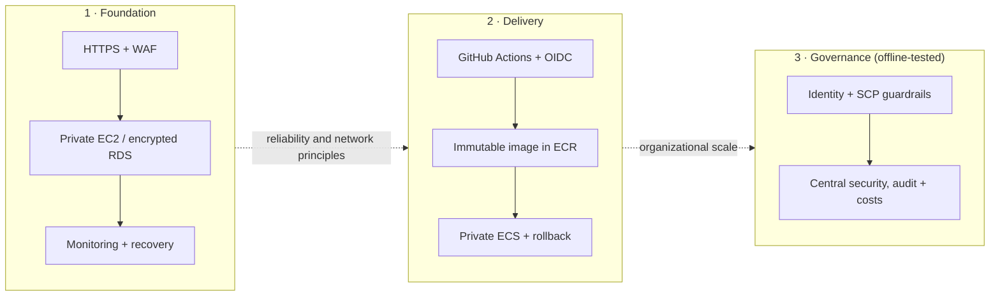

# RSVP Cloud Platform

**One AWS engineering portfolio, built from a real business decision.**

I built [RSVP Society](https://github.com/JNHolman/rsvp-society) to manage private events—members, invitations, RSVPs, and guest check-in. When I first moved the business toward AWS, I designed a traditional enterprise-style environment with networking, EC2 application servers, load balancing, and a relational database.

The design made technical sense, but not business sense. Events create bursts of traffic, not a constant workload that justifies paying for a full infrastructure stack all month. I moved RSVP Society toward an event-driven design using AWS Lambda, API Gateway, DynamoDB, and EventBridge.

I kept the original infrastructure work and developed it into **RSVP Cloud Platform**. The business needed a leaner system; I wanted to explore what it takes to design, deliver, secure, and operate a larger one.

## One platform, three connected parts

| Part | What I built | The engineering question |
| --- | --- | --- |
| **[1. Cloud Foundation](project-1-cloud-foundation/README.md)** | Private AWS networking, EC2, a protected HTTPS edge, encrypted RDS, monitoring, and recovery | Can I build infrastructure that is secure, observable, and recoverable? |
| **[2. ECS & CI/CD](project-2-ecs-cicd/README.md)** | Private ECS Fargate workloads, GitHub Actions, OIDC authentication, immutable images, and rollback | Can I release changes without sacrificing security or reliability? |
| **[3. Cloud Governance](project-3-cloud-governance/README.md)** | Multi-account identity, policy, security, logging, and cost controls | How do those standards hold up when an organization grows? |

These are connected engineering layers, not three unrelated tutorials. Foundation establishes the networking and reliability principles. Delivery applies them to containers and software releases. Governance explores the controls needed across more teams and AWS accounts.

The original EC2 and ECS exercises were run separately. This diagram shows their **engineering progression**, not a claim that all three layers were deployed together.

## What makes this more than a standard AWS demo

My background is in enterprise network engineering, where the hard part is rarely just getting something online. It's understanding traffic paths, limiting the impact of failures, making controlled changes, and having enough evidence to troubleshoot.

That mindset shaped the platform:

- **Network and security boundaries.** Internet traffic reaches a protected HTTPS entry point; application and database resources stay in private networks.
- **Repeatable infrastructure.** Terraform defines the environment, while the application release pipeline owns new software versions. One should not unexpectedly undo the other.
- **Release accountability.** GitHub Actions uses short-lived AWS credentials through OIDC, and container images are tied to a Git commit rather than a mutable `latest` tag.
- **Recovery that gets tested.** I deliberately exercised database restoration and a failed container release rather than treating backup and rollback settings as proof.
- **Governance with limits.** I modeled how identity, security findings, audit records, and costs would be managed across accounts. That part has offline tests, not a claim of a running six-account organization.

I also learned when **not** to add infrastructure. The serverless pivot for RSVP Society was just as important an engineering decision as the more advanced controls in this portfolio.

## What I actually demonstrated

### Foundation: a private AWS application

The live exercise confirmed two healthy private EC2 targets in different Availability Zones, HTTPS access, a WAF rejection, and CloudWatch alarm transitions. I also restored an encrypted RDS snapshot and read back a known test record.

**Measured database restore: 10 minutes 2 seconds.** The application page and database recovery were tested separately; this exercise did not prove an end-to-end application-to-database request.

[Foundation design](project-1-cloud-foundation/README.md) · [Dated test record](project-1-cloud-foundation/evidence/2026-11-08.md)

### Delivery: an identifiable release and a working rollback

I used GitHub Actions and OIDC to release an immutable image to private ECS tasks. The running tasks matched the expected image digest. I then introduced an intentionally broken ECS revision; the deployment circuit breaker returned the service to its previous healthy version.

**Measured ECS rollback: 13 minutes 47 seconds.** A later image rebuild reduced reported HIGH ECR scan findings from nine to two. The successful native ECS rollback is separate from the workflow's other recovery path.

[Delivery design](project-2-ecs-cicd/README.md) · [Dated test record](project-2-ecs-cicd/evidence/2026-11-08.md) · [Successful controlled release](https://github.com/JNHolman/RSVP-Cloud-Platform/actions/runs/42458363871)

### Governance: tested design, not a claimed deployment

The governance layer models AWS Organizations, service control policies, Identity Center, security and log-account separation, and cost analysis. Terraform and Python tests exercised policy generation and application behavior. **Live multi-account enforcement has not been demonstrated.**

[Governance design and verification](project-3-cloud-governance/README.md)

The two images above are actual application screenshots from the dated exercises. They demonstrate the application pages, not every AWS control. The linked records contain the underlying observations; additional AWS-console screenshots were not retained, so I am not presenting reconstructed images as proof.

## The decisions behind the design

| Decision | Why it mattered |
| --- | --- |
| Move RSVP Society to serverless | Stop paying for infrastructure the event business did not need continuously |
| Keep workloads private | Make the traffic path intentional and reduce direct exposure |
| Use Fargate rather than Kubernetes | Learn and demonstrate delivery, networking, and recovery without an unnecessary cluster to manage |
| Separate Terraform and release ownership | Keep infrastructure changes from silently reverting a working application version |
| Keep AI advisory | Use it to summarize operational evidence without granting it authority to change infrastructure |
| Test governance offline | Validate what can be proven locally without pretending to operate six AWS accounts |

## Where this leaves the project

The platform demonstrates infrastructure design, automated delivery, security controls, troubleshooting, and recovery—but it is an **engineering portfolio**, not a continuously running production service. The dated results apply to the exact versions tested. Newer integration work needs its own verification.

For the technical details, follow the three project links above. The infrastructure, application code, tests, and original evidence are kept with their relevant project.

**Josh Holman** · Network / Cloud Infrastructure Engineer  
AWS · Terraform · Python · GitHub Actions · Enterprise Networking
