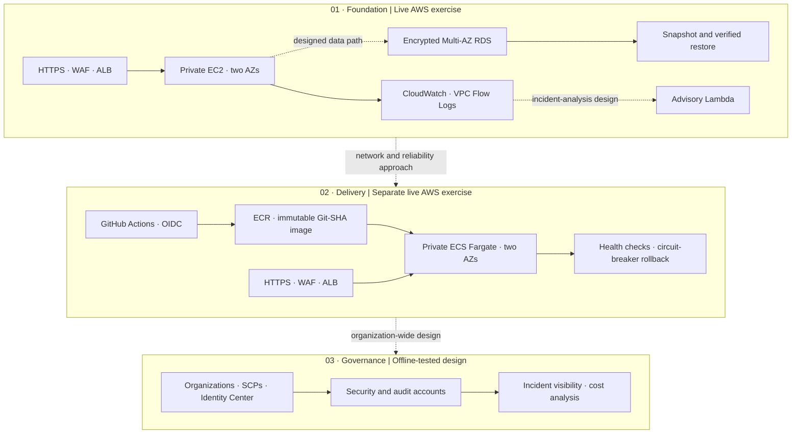

# RSVP Cloud Platform

**One cloud engineering portfolio, built from a real business decision.**

I built [RSVP Society](https://github.com/JNHolman/rsvp-society) to manage private events: membership approvals, invitation waves, text-message RSVPs, guest limits, and check-in. Building that application forced me to make a decision I encounter in infrastructure engineering: **what does the business actually need, and what is unnecessary complexity?**

## Why the architecture changed

My first AWS design used familiar enterprise components: a VPC, an Application Load Balancer, EC2 servers, and a relational database. It was a reasonable model for a service with steady demand. But RSVP Society gets busy around invitations and event days, not around the clock.

I moved the live business toward serverless services so the infrastructure matched that pattern.

| Original enterprise approach | RSVP Society's serverless direction | Why it changed |
| --- | --- | --- |
| Always-available EC2 application tier | API Gateway + AWS Lambda | Process requests when they arrive instead of running application servers continuously |
| Managed relational database infrastructure | DynamoDB | Use managed, on-demand capacity for members, invitations, and event activity |
| Load-balanced server delivery and scheduled server-side work | CloudFront + EventBridge-driven scheduling | Deliver the frontend efficiently and run event tasks when needed |

The pivot wasn't because traditional infrastructure is wrong. **It was the wrong operating model for this business.** I kept that engineering work and expanded it into RSVP Cloud Platform to explore the security, delivery, and governance needs of a larger AWS environment. The business application and this portfolio are separate.

## One platform, three connected parts

| Part | Engineering focus | Question it answers |
| --- | --- | --- |
| [**01 · Cloud Foundation**](project-1-cloud-foundation/README.md) | Private networking, EC2, encrypted RDS, WAF, monitoring and recovery | Can I make a traditional application secure, observable, and recoverable? |
| [**02 · ECS & CI/CD**](project-2-ecs-cicd/README.md) | Private Fargate services, GitHub Actions, OIDC, ECR and deployment rollback | Can I ship software changes without losing control of the running service? |
| [**03 · Cloud Governance**](project-3-cloud-governance/README.md) | Organization guardrails, identity, centralized security, logging and costs | How would those standards be applied across teams and accounts? |

Foundation establishes the network and recovery design. Delivery applies the same security and reliability approach to containers and releases. Governance takes the question beyond a single application account.

This is a **progression in engineering scope**, not a claim that all three environments were deployed as one live system. Foundation and ECS were exercised independently. The six-account governance design has been tested offline.

## What I actually demonstrated

### Foundation — private infrastructure and database recovery

In the November 8, 2026 exercise, two private EC2 instances in separate Availability Zones served traffic through an HTTPS load balancer. I verified WAF blocking and a CloudWatch alarm entering and leaving its alarm state.

I also restored an encrypted RDS snapshot to a separate private database and read back a known record over TLS in **10 minutes 2 seconds**. The webpage and database were tested separately; an application-to-database request was **not** verified in that exercise.

[Technical decisions and code](project-1-cloud-foundation/README.md) · [Test evidence](project-1-cloud-foundation/evidence/2026-11-08.md)

### Delivery — identifiable releases and tested rollback

GitHub Actions authenticated with short-lived credentials through OIDC and deployed a Git-SHA-tagged image to private ECS tasks. Their running image digest matched the ECR artifact. When I introduced a task revision that deliberately failed to start, ECS recovered to the previous healthy release in **13 minutes 47 seconds**.

This proved the native ECS circuit-breaker rollback, not the separate workflow smoke-test rollback. A later image rebuild reduced ECR HIGH findings from nine to two.

[Technical decisions and code](project-2-ecs-cicd/README.md) · [Release evidence](project-2-ecs-cicd/evidence/2026-11-08.md) · [GitHub Actions run](https://github.com/JNHolman/RSVP-Cloud-Platform/actions/runs/42458363871)

### Governance — enforceable policies as code, tested offline

The six-account reference design separates management, security, audit, shared services, nonproduction, and production responsibilities. Its SCPs include controls to prevent member accounts from leaving the organization and to restrict disabling CloudTrail, AWS Config, GuardDuty, and Security Hub in workload environments. Account-level exceptions are explicitly scoped.

Terraform and Python tests check these policies and the supporting security and cost-analysis logic. **I have not deployed or verified the six-account design in AWS.**

[Governance design, policy implementation and tests](project-3-cloud-governance/README.md)

## Decisions behind the work

I brought my enterprise network engineering background to the parts that tend to fail under pressure: understanding the traffic path, reducing exposure, making changes deliberately, and knowing what to check when something breaks.

- **Private by design:** The load balancers accept public HTTPS traffic. EC2, ECS, and the database are placed behind deliberate subnet and security-group boundaries.
- **Infrastructure and releases have different owners:** Terraform defines ECS infrastructure; GitHub Actions promotes application revisions. This prevents a routine infrastructure update from silently reverting a working release.
- **Recovery needs evidence:** A database snapshot existing is not the same as a successful restore. A deployment rollback setting is not the same as seeing the previous version return healthy.
- **Automation has limits:** AI incident analysis produces advisory findings, not infrastructure changes. Governance tests establish implemented behavior, not live organization-wide enforcement.

The most important lesson connects back to RSVP Society: **strong engineering is choosing the right controls for the workload, including knowing when not to use them.**

This repository is the engineering portfolio, not the production RSVP Society application or an installation guide. The linked project pages explain the implementation; the dated reports show what was observed rather than what the configuration alone suggests.

**Josh Holman** · Network / Cloud Infrastructure Engineer
