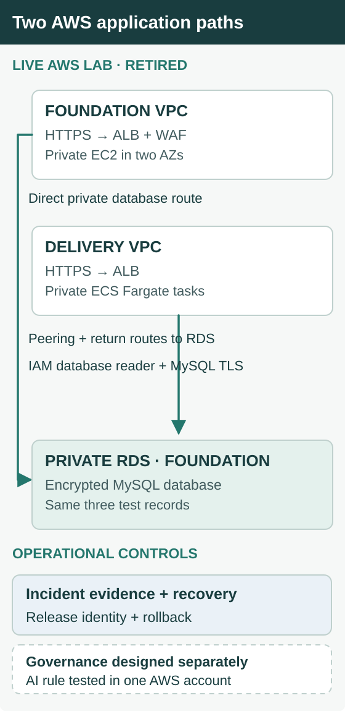

# RSVP Cloud Platform

An Application Load Balancer can report healthy targets while an application serves the wrong release. A database restore can finish without proving that the expected records survived. An AI assessment can sound convincing without enough evidence to establish a cause.

**RSVP Cloud Platform tests those gaps instead of treating green infrastructure status as proof that a service works.** I originally built the AWS hosting environment for [RSVP Society](https://github.com/JNHolman/rsvp-society), a private-event platform with bursts of invitation, RSVP, and check-in traffic. Keeping servers and a highly available database running between events added unnecessary overhead, so the live business moved toward event-driven services.

I kept a separate, read-only reservation lab with no production guest data. Cloud Foundation tested investigation and database recovery. ECS & CI/CD tested release identity and rollback. Cloud Governance examined independent security authority and audit custody. The first two projects were exercised in AWS; the six-account governance architecture was validated offline, with one AI severity guardrail tested in a single AWS account. The active lab infrastructure has since been retired.

## Recorded exercise evidence

*This 25-second animation reconstructs three exercises from saved records; it is not footage of a running service.* [Incident record](project-1-cloud-foundation/evidence/live-incident.json) · [Rollback record](project-2-ecs-cicd/evidence/live-release-recovery.json) · [Priority decision](project-3-cloud-governance/evidence/aws-incident-exercise.json)

## What the results mean

| Operational question | Observed result | Why it matters |
| --- | --- | --- |
| Can an alarm become a usable investigation? | 77 log entries analyzed; report stored and delivered to a test queue | Gives an engineer evidence and suggested checks rather than an unexplained alert |
| Can an apparently healthy bad release be stopped? | Previous revision verified after **3m 23s** | A running container alone does not establish release correctness |
| Can the database be restored to the expected state? | Snapshot row verified in **10m 02s**; PITR marker read in **13m 50s** | Recovery requires a successful data read, not just an AWS job status |
| Can AI be prevented from downgrading a critical finding? | Model P3 overridden by policy P1; both persisted | Policy remains authoritative while the model's reasoning stays visible |

These are **exercise measurements, not production SLOs**. Other recorded results include AWS Backup completion in **16m 48s** with later row verification, RDS Multi-AZ failover in **19.85s** (database operation only), and ECS scale-out from two to three running tasks under a 1,625-request test.

## The engineering journey

### [1. Cloud Foundation — investigate and recover](project-1-cloud-foundation/README.md)

A failed health check identifies a symptom, not its cause. I put the application behind WAF and an HTTPS load balancer, kept EC2 and MySQL private, and built an alarm-driven Lambda investigation that stores bounded, redacted log evidence separately from the model's assessment. I then tested encrypted snapshot, point-in-time, and AWS Backup recovery against known database records.

**The distinction:** an alarm is not a diagnosis, and a completed restore is not proof of recovered data. [Incident evidence](project-1-cloud-foundation/README.md#ai-incident-analysis) · [Recovery results](project-1-cloud-foundation/README.md#recovery-evidence)

### [2. ECS & CI/CD — reject a bad release](project-2-ecs-cicd/README.md)

The same reservation service moved into a second private VPC on ECS Fargate, still reading the Foundation database. GitHub Actions used OIDC and immutable ECR images to deploy it. ECS protected against tasks that would not stabilize; a separate HTTPS check rejected a healthy deployment serving the wrong revision.

**The distinction:** task health and release correctness are different signals. Both failure paths were exercised separately in AWS. [Release evidence](project-2-ecs-cicd/README.md#live-integrated-release-on-november-8)

### [3. Cloud Governance — separate security authority](project-3-cloud-governance/README.md)

Application operators should not also control the policies that constrain them or the audit records used to investigate them. I designed a six-account AWS Organizations hierarchy with separate security, log archive, shared services, and workload responsibilities. The organization remains **offline-tested, not deployed**. In a separate single-account AWS exercise, deterministic code prevented AI from downgrading a labeled critical finding.

**The distinction:** a model may advise, but policy decides; a design isn't presented as a deployed control. [Security evidence](project-3-cloud-governance/README.md#live-aws-exercise)

## Follow the architecture

The two application paths were exercised in AWS. Foundation uses an ALB and private EC2; Delivery uses private ECS tasks in a second VPC. Peering and scoped database access let both paths read the **same three test records** from private RDS. That shared readback was important: a green load balancer or container status was not enough to prove the application could reach its data.

The governance organization in Project 3 is a **separate, offline-validated design**, not a set of six accounts deployed around the first two projects.

## Engineering trade-offs

**Prove the behavior a client depends on.** Target health and successful AWS jobs are useful signals, but I verified the served HTTPS version and database rows separately. Those checks caught problems infrastructure status alone could miss.

**Keep AI advisory and its inputs bounded.** The incident investigator limits and redacts logs, validates model output, and records a fallback when analysis fails. The security investigator retains the model's recommendation but enforces a code-defined severity floor. Neither system can remediate infrastructure.

**Avoid creating risk for the live business.** The lab uses separate resources and Terraform state from RSVP Society. Its runtime has been retired to avoid unnecessary ongoing charges. I retained recorded evidence rather than presenting an inactive demo URL as live.

For deeper decisions, implementation, and boundaries, read the projects in order: [Foundation](project-1-cloud-foundation/README.md) → [ECS & CI/CD](project-2-ecs-cicd/README.md) → [Governance](project-3-cloud-governance/README.md). The repository also includes [CI](.github/workflows/ci.yml) and the [infrastructure security review](shared/checkov-review.md).

Validation boundaries, teardown, and retained resources

Project 1's alarm was **operator-set** to test automatic investigation; it was not a naturally triggered 5xx threshold event. Human email receipt was not tested. The later database-aware Project 2 release checks passed tests with **simulated workflow responses** after the ECS/RDS runtime was retired; they were not rerun live. Project 3's six-account organization, cross-account security controls, and dashboard were not deployed. AWS Config aggregation would only cover member accounts **where Config recording is enabled**.

Reviewed teardown plans excluded RSVP Society production databases, DNS, and IAM. Terraform removed 80 Foundation, 60 ECS, and two temporary delivery resources. Two ECS task definitions remained registered. Encrypted snapshots, a completed AWS Backup recovery point, incident records, and protected keys were retained. **Project 1 recovery KMS keys have intentional Terraform destruction guards**; I **do not expect an unrestricted `terraform destroy`** to remove them. **RDS recovery points inherit the database encryption key.** Retained snapshots, recovery points, and keys may continue to cost money. Without active cost-allocation tags, I did not claim a standalone lab bill.

Checkov reports advisory findings; a green CI result is not proof of zero infrastructure risk. See the [disposition of 42 original findings](shared/checkov-review.md).

