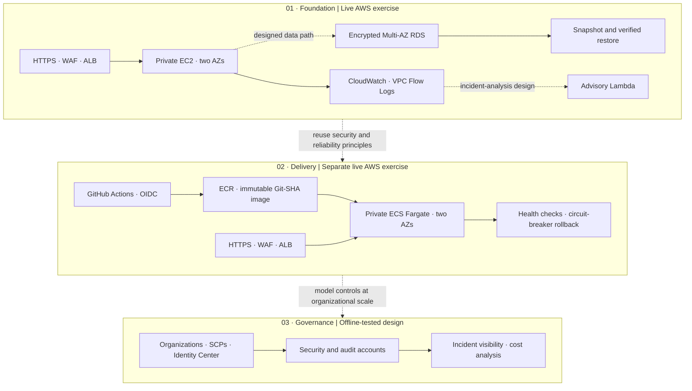

# RSVP Cloud Platform

**One AWS engineering project, developed from a real business decision.**

RSVP Cloud Platform shows how I approach cloud infrastructure as a network engineer: understand the workload, build secure systems, automate changes, investigate failures, and prove that recovery works. It has three connected parts—**Foundation, Delivery, and Governance**—that follow the same engineering principles at increasing scale.

## It started with RSVP Society

[RSVP Society](https://github.com/JNHolman/rsvp-society) is the private-event platform I built to manage an approved member community, invitation waves, text-message RSVPs, +1s, capacity, and guest check-in. It solves a practical problem: keeping the guest list accurate while invitations, cancellations, and event-day changes happen.

My first AWS design followed a traditional enterprise model: a VPC, load-balanced EC2 servers, and a relational database. That could support a continuously active application, but it meant paying for infrastructure even between events. RSVP Society's workload is different. Invitations and event days create spikes of activity, with much less demand in between.

I changed the business architecture to fit that reality. The application now uses **API Gateway and Lambda** for requests, **DynamoDB** for application data, **EventBridge** for scheduled work, and **CloudFront** for delivery. Instead of keeping servers running for occasional bursts, the business uses managed services that do work when it is needed.

That pivot wasn't a rejection of enterprise infrastructure. It was a judgment about **which architecture belonged in the business**. I kept the original engineering direction and developed it into this separate cloud platform portfolio.

## One platform, three connected parts

| Part | The problem it addresses | What it contains |
| --- | --- | --- |
| **[01 · Cloud Foundation](project-1-cloud-foundation/README.md)** | How do I protect and recover a traditional application? | AWS networking, private EC2, HTTPS/WAF, encrypted RDS, monitoring, backup, incident analysis |
| **[02 · ECS & CI/CD](project-2-ecs-cicd/README.md)** | How do I deliver changes reliably? | Private ECS Fargate, ECR, GitHub Actions, OIDC, image scanning, release validation, rollback |
| **[03 · Cloud Governance](project-3-cloud-governance/README.md)** | How would these standards scale across an organization? | AWS Organizations, SCPs, IAM Identity Center, central security, audit logging, cost visibility |

**Foundation** establishes the security, networking, and recovery pattern. **Delivery** carries those principles into containers and application releases. **Governance** models the organizational controls around both.

They form **one engineering story**, but not one continuously deployed AWS environment. The EC2 and ECS exercises were deployed and tested separately. Governance is an offline-tested multi-account design. The diagram distinguishes those boundaries.

## What I built, tested, and learned

### 01 · Cloud Foundation — make the network and recovery observable

The public entry point is an HTTPS load balancer protected by AWS WAF. Application servers live in private subnets across two Availability Zones; the database is private and encrypted. Security groups restrict the traffic between tiers, while application logs, flow logs, and CloudWatch alarms provide the evidence needed to investigate problems.

The November 8 AWS exercise confirmed **two healthy private targets**, working HTTPS, a blocked WAF test request, and an alarm moving from ALARM back to OK. I restored a snapshot to a separate RDS instance and read the original test record over TLS in **10 minutes 2 seconds**.

That last check matters: a configured backup is not the same as a successful restore. The web page and RDS recovery were tested **separately**; I did not prove that this version of the web application could query the database. The incident-analysis Lambda was directly tested, not proven end to end from an alarm.

[Foundation: technical design and findings](project-1-cloud-foundation/README.md) · [Original test evidence](project-1-cloud-foundation/evidence/2026-11-08.md)

### 02 · ECS & CI/CD — make releases traceable and recoverable

I carried the private-networking and health-check approach into ECS Fargate. GitHub Actions runs tests and scanning, obtains short-lived AWS credentials through OIDC, and releases an image identified by its Git commit. Terraform owns the infrastructure baseline; the deployment workflow owns application revisions so an infrastructure update doesn't silently replace a newer release.

The first container launch exposed a real issue: Gunicorn needed to write a temporary file, but the container ran with a read-only root filesystem. I moved its worker heartbeat files to `/dev/shm` instead of removing the security restriction.

I then deliberately deployed a revision that could not start. The ECS circuit breaker returned the service to its previous healthy version in **13 minutes 47 seconds**. An image rebuild later reduced ECR's reported HIGH findings from **nine to two**. The separate GitHub smoke-test rollback path was not tested by that failure injection.

[Delivery: technical design and findings](project-2-ecs-cicd/README.md) · [Release and rollback evidence](project-2-ecs-cicd/evidence/2026-11-08.md) · [GitHub release run](https://github.com/JNHolman/RSVP-Cloud-Platform/actions/runs/42458363871)

### 03 · Cloud Governance — model security beyond one AWS account

The first two parts protect workloads. The third asks who controls access, policies, security findings, audit records, and costs when those workloads span an organization.

I designed a **six-account reference architecture** with separate management, security, log archive, shared services, nonproduction, and production responsibilities. Terraform models service control policies and identity permissions; Python components handle bounded security and cost analysis. The separation is deliberate: an application team shouldn't be able to casually change the controls or evidence used to monitor its own account.

**This part has not been deployed as a six-account environment.** Terraform and Python tests validate policy generation, configuration, and handler behavior. They do not establish that AWS enforced those policies in live member accounts.

[Governance: architecture and offline verification](project-3-cloud-governance/README.md)

## Engineering decisions that carried through

- **Fit the business, not the diagram.** An always-on architecture was useful to study, but serverless was the better fit for RSVP Society's event-driven workload.
- **Design for investigation.** Private networks, restricted security-group paths, logs, and health signals are useful only when they help isolate an actual failure.
- **Separate infrastructure from application releases.** Terraform establishes the environment; an explicit release pipeline changes running software. Their responsibilities should not conflict.
- **Keep automation accountable.** OIDC limits credential exposure, immutable images establish what shipped, rollback is measured, and AI incident analysis stays advisory rather than taking action.
- **Distinguish design from proof.** The foundation restore and ECS rollback were measured in AWS. Governance and several additional recovery paths remain design or offline-test results.

## Project status

This is an **engineering portfolio**, not the live RSVP Society application and not a product someone is expected to install. The results above are tied to the November 8, 2026 exercises; subsequent integration work needs its own validation. The linked technical pages and dated test records distinguish what the code defines from what I actually demonstrated.

**Josh Holman** · Network / Cloud Infrastructure Engineer
