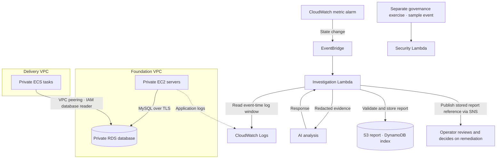

# RSVP Cloud Platform

**I built an AWS environment that investigates service failures, rejects bad releases and preserves the evidence behind a security alert.** I used the same read-only reservation service to test how much of that work could be automated and where an engineer still had to make the decision.

*25-second reconstruction from recorded exercises.* [Investigation and original report](project-1-cloud-foundation/README.md#ai-incident-analysis) · [Rollback timeline](project-2-ecs-cicd/README.md#live-integrated-release-on-november-8) · [Security decision and receipt](project-3-cloud-governance/README.md#live-aws-exercise)

When RSVP Society sends a wave of invitations, guests reply, change plans and bring friends. Between events there may be very little work for the application to do. My first AWS design kept application servers and a highly available database running throughout those quiet periods. For the business, it made more sense to pay for work as requests arrived. I moved the production application toward event-driven services. [RSVP Society and its event operations](https://github.com/JNHolman/rsvp-society)

I kept the original design to answer a question from my work in network operations: when a request fails, can I follow it from the public entry point to the database and prove when service recovers?

I used Terraform to build private AWS networks around two ways to serve the same application: EC2 virtual machines and ECS Fargate containers reading from an RDS database. GitHub Actions automated the build, security scan, deployment and recovery of container releases. When a CloudWatch alarm changed state, a Python function in Lambda collected evidence for an AI-assisted investigation. The governance design separates who can deploy a workload from who can administer security policy. In the live security exercise, an explicit priority rule controlled the alert after AI triage.

## How the lab fits together

The database was the common test point. Both applications had to read the same reservation through their own network path and AWS role. The governance exercise used a separate event source so I could test security policy without changing production monitoring.

## Verified in the AWS exercises

| What was measured | Recorded outcome |
|---|---|
| [Incident investigation](project-1-cloud-foundation/README.md#ai-incident-analysis) | **77 log entries** analyzed; report saved and notification received. |
| [Version verification and rollback](project-2-ecs-cicd/README.md#live-integrated-release-on-november-8) | **3m 23s** from rejection to verification of the previous release. |
| [ECS circuit breaker](project-2-ecs-cicd/evidence/2026-11-08.md) | **13m 47s** to recover a separate unhealthy deployment. |
| [Encrypted snapshot recovery](project-1-cloud-foundation/README.md#recovery-evidence) | **10m 02s** to a verified database row. |
| [Service scale-out](project-2-ecs-cicd/README.md#capacity-under-load) | **2 to 3 running tasks** under load. Scale-in remains unverified. |
| [Security investigation](project-3-cloud-governance/README.md#live-aws-exercise) | Model proposed **P3**; policy enforced **P1**. Both were recorded. |

The later database-aware release checks used simulated workflow responses. The enterprise governance design has offline policy tests; cross-account enforcement remains unverified.

## Engineering Decisions and Trade-offs

**Production isolation.** The lab shared an AWS account with Society. Dedicated resource names, Terraform state keys and a delegated DNS zone under `cloud.rsvpsociety.com` bounded the exercise. Reviewed plans excluded Society’s database, IAM identities and production DNS. An older development resource with unclear ownership was left alone.

**Release ownership.** Foundation owned the database and private network. Delivery owned the peering connection, return routes and reader permissions. Separate state let me retire the consumer first. Terraform managed the infrastructure baseline, while GitHub Actions promoted application revisions. In the governance design, AWS Config aggregation covers accounts only where Config recording is enabled.

Retired resources, continuing costs and security findings

**Recovery and cost.** Terraform retired 80 foundation resources, 60 ECS runtime resources and two temporary delivery resources. Release task definitions 6 and 7 remained registered after service retirement. The final RDS snapshot was available and encrypted. RDS recovery points inherit the database encryption key. Project 1 recovery KMS keys have intentional Terraform destruction guards, so I do not expect an unrestricted `terraform destroy` to remove them alongside the runtime.

The encrypted snapshots, completed AWS Backup recovery point, log buckets and incident index were retained. Keys and storage can continue to incur charges. No cost-allocation tags were active during the exercise, so the portfolio’s share of the bill could not be established.

The infrastructure scan is advisory. The review covers IAM scope, reachability, encryption and monitoring across the three layers. [Disposition of the 42 Checkov findings](shared/checkov-review.md)

For RSVP Society, the useful decision was knowing when the business could dispense with always-on servers. For the enterprise platform, the useful test was what an operator could establish during a failure. A release was back in service when the expected version answered over HTTPS. A backup was usable when a restored database returned the expected row. An AI investigation earned its place by giving the engineer a specific next check and enough evidence to judge the answer.

**Josh Holman** — Network / Cloud Infrastructure Engineer
