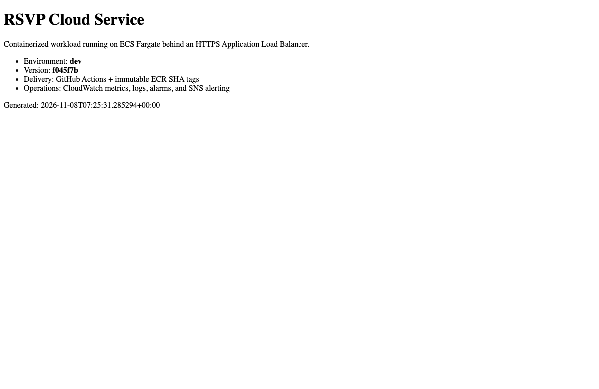

# Project 2 live exercise, November 8, 2026

I deployed the dev workload to us-east-1 and exercised a failed release with two healthy tasks already serving traffic. The delivery bootstrap created seven resources, and the initial runtime plan created 67. The initial task failed before it could serve requests. The container ran as the app user with a read-only root filesystem, and Gunicorn could not open a temporary file in the task-mounted /tmp directory. I configured Gunicorn to keep worker heartbeat files in /dev/shm and repeated the launch with the same image.

## Release and recovery evidence

| Capability | Live result |
|---|---|
| GitHub OIDC and immutable image | The dev workflow assumed its scoped role, ran application tests and Trivy, and pushed the full Git SHA tag. Both running tasks reported the same digest as the immutable ECR image. |
| Private compute and HTTPS | Two healthy ALB targets mapped to private task ENIs in us-east-1a and us-east-1b. Neither ENI had a public IP. HTTPS /health returned status ok, environment dev and version f045f7b. |
| WAF and observability | The regional ACL was associated with the ALB. A synthetic XSS query returned 403. Five CloudWatch app streams had ingested events. The dev service had CPU and memory alarms and an autoscaling range of two to six tasks. A load-driven scaling event remains untested. |
| Native rollback | At 02:25:41 EST I registered revision 4 using the same image and an intentionally failing container command. ECS reported that the tasks failed to start. At 02:39:28 EST the previous revision 3 was serving the expected SHA again with two running tasks. No operator update was needed for recovery. |

The GitHub controlled-deploy run exercised its successful smoke-test path. The failed revision was introduced separately through ECS to isolate native circuit-breaker behavior. GitHub dev had no reviewer protection rules at the time of this test. Stage and prod were outside the exercise.

[First-image workflow](https://github.com/JNHolman/RSVP-Cloud-Platform/actions/runs/42454219252) · [Controlled release workflow](https://github.com/JNHolman/RSVP-Cloud-Platform/actions/runs/42458363871) · [Captured observations and scan findings](evidence/project-2-2026-11-08/observations.json)

## Vulnerability findings

The GitHub Trivy gate passed with HIGH/CRITICAL filtering and ignore-unfixed enabled. ECR's separate basic scan of the Linux/amd64 manifest reported **9 high, 10 medium and 3 low** findings. The SHA-tagged top-level object is an OCI index. The platform-specific scan digest and high-severity package/CVE list are in the captured observations. Remediation and rescanning remain outstanding before considering promotion.

## Teardown and cost

At 02:49 EST, AWS inventory showed zero active demo ECS clusters, ALBs, NAT gateways, allocated demo EIPs, demo VPCs and workload DNS records. ECS had already reported zero running and pending tasks. Terraform removed 54 runtime resources. I deregistered the workflow release revision, retired the temporary dev deploy role and policy, and reconciled the four dev GitHub Environment variables to their prior values. A future release needs that role and configuration provisioned again.

I retained the scanned ECR image and repository, its lifecycle policy and encryption key, the OIDC provider, the observability key, log groups, versioned access-log bucket and dedicated backend. Two Project 2 customer-managed KMS keys have a baseline of roughly $2/month before rotations and requests. ECR image storage, log and object storage, and requests remain usage-based. The runtime planning estimate was $0.18/hour before usage. Actual billed charges require a later billing report. The child zone continues to serve its retained delegation.
