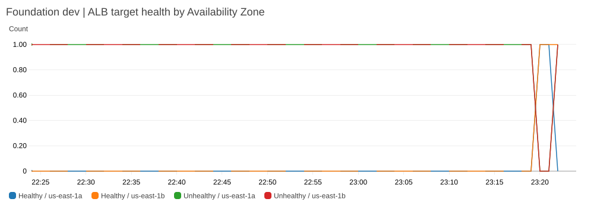

# Project 1 — Cloud Foundation

When I moved RSVP Society to a lighter serverless design, I kept the original three-tier AWS architecture as a place to learn. Cloud Foundation is the starting point for the rest of the platform: an HTTPS entry point, private application servers and a private database, built with Terraform.

What I wanted to understand was what happens beyond the point where an application loads successfully. From network engineering, I know a working route doesn't always mean the service behind it works. I followed requests through the application and database, collected logs around a failure, and restored data to check whether the backups were actually useful.

Those exercises gave me a working application path and a database I could reuse in [Project 2](../project-2-ecs-cicd/README.md), instead of building an unrelated demo for every technology I wanted to test.

[Back to the platform story](../README.md) · [The container release built on this foundation](../project-2-ecs-cicd/README.md)

## Following a request through AWS

~~~mermaid
flowchart TB
    guest["Guest's browser"] -->|"HTTPS"| alb["Public load balancer · TLS + AWS WAF"]
    subgraph vpc["Foundation VPC"]
      alb --> web["Private EC2 application · two Availability Zones"]
      web -->|"Scoped IAM database reader + MySQL over TLS"| rds[("Private encrypted Multi-AZ RDS")]
    end
    web --> logs["CloudWatch application logs"]
    alb --> alarms["Health checks + CloudWatch alarms"]
    alarms --> analysis["EventBridge → investigation Lambda"]
    logs --> analysis
    analysis -->|"Bounded, redacted context"| ai["AI assessment"]
    analysis --> records["Encrypted S3 report + DynamoDB index"]
    records --> notify["SNS → encrypted SQS test subscriber"]
    rds --> recovery["Snapshots · point-in-time recovery · AWS Backup"]
~~~

The load balancer is the public front door. AWS WAF filters suspicious web requests there. Private EC2 servers run the application in two Availability Zones, so it isn't tied to a single data-center location. The RDS database has no public endpoint. The servers use their assigned AWS identity to authenticate and make an encrypted MySQL connection. Their network rules allow only the traffic needed along that path.

Terraform defines the network, security rules, monitoring and recovery settings. I then checked the running environment from the public HTTPS endpoint through to a real reservation record in the private database. That gave me more useful evidence than a successful Terraform apply.

### What I verified at the network edge

The development exercise provided a useful set of checks beyond “the page loads.” The load balancer was protected by an issued ACM certificate and served HTTPS. Its two healthy private EC2 targets were in separate Availability Zones, without public instance addresses. A harmless test request containing an XSS pattern received an HTTP 403 from the associated WAF, and VPC Flow Logs plus application logs were available for troubleshooting.

Those checks matter for different reasons. The certificate proves the public endpoint is configured for TLS; the private targets show where application traffic terminates; the WAF response shows the specific test request was blocked. None of those alone proves that a reservation query works. That's why I followed the request all the way to private MySQL.

[First deployment observations](evidence/2026-11-08.md) · [Network design](terraform/vpc.tf) · [Web ingress and health checks](terraform/alb.tf) · [WAF rules](terraform/waf.tf)

## Live integration on November 8

I deployed the Flask reservation service against private RDS, inserted test records and read them back through the EC2 application. Later, the ECS version of the same service accessed that database from a separate VPC. Both HTTPS endpoints returned the same three records. That established two distinct network and identity paths to the same data—not two unrelated applications that happened to return “healthy.”

The first EC2 rollout failed before the application started: Gunicorn couldn't open the stderr path configured in systemd. I corrected the logging path and repeated the rollout. The load balancer's health metrics captured the transition from unhealthy to healthy targets.

[Read the live reservation response](evidence/live-rds-reader.png) · [Integration and recovery evidence](evidence/live-recovery.json) · [Earlier HTTPS, WAF and network observations](evidence/2026-11-08.md)

### AI incident analysis

An alarm is a starting point, not a diagnosis. I built a Python Lambda handler that takes CloudWatch alarm context, gathers a small window of application logs around the event and asks an AI model to help interpret the evidence.

For the live exercise, I **manually put the development load balancer's 5xx alarm into ALARM state** to test the notification and investigation path. The handler gathered **77 log entries**. The alarm transition was deliberate; the 503 errors found in the log window were real observations from the earlier application rollout.

The logs showed three failed health checks and then healthy responses by 23:19:59 UTC. The model pointed to Apache being unable to connect to its local application backend as the likely cause of the 503s. That was consistent with the evidence, but the sample did **not** prove why the backend had been unavailable. The actual startup failure had been traced separately to Gunicorn's systemd logging path. I kept the model's narrower conclusion rather than present its suggestion as a verified root cause.

The useful part of the report was the next check: confirm that the application answers, a reservation can still be read from the database and the load balancer considers its servers healthy. Those are three different signals. A web process answering does not by itself prove that the full service works.

~~~mermaid
sequenceDiagram
    participant A as Alarm / EventBridge
    participant L as Investigation Lambda
    participant C as CloudWatch Logs
    participant M as AI model
    participant S as Encrypted S3 + DynamoDB
    participant Q as SNS / encrypted SQS
    A->>L: Alarm state, reason and event time
    L->>C: Read the event-time log window
    C-->>L: 77 entries in recorded exercise
    L->>M: Redacted context and bounded sample
    M-->>L: Likely explanation and next checks
    L->>L: Validate response or use fallback
    L->>S: Save report and index
    L->>Q: Send stored report reference
~~~

I put limits around this process because an AI explanation is only as useful as the evidence supporting it. The current handler caps a sample at 120 entries. The encrypted AWS report retains bounded log text with pattern-based masking. The external request contains only the alarm category and state, sample size, collection status, HTTP status counts and number of lines mentioning a refused connection. This narrower payload and the replay handling were tested offline after the live exercise. CloudWatch alarms when either model fallback or log collection failure occurs at least twice within one 15-minute period. Inspect the recent stored investigations to identify the affected alarms. The handler validates the expected output fields and confidence. If log collection fails, the report says so. If the model fails or returns an invalid answer, a low-confidence fallback preserves the alarm details instead of presenting an invented diagnosis.

In the recorded exercise the model response passed validation, the report was stored in KMS-encrypted S3 and indexed in DynamoDB, and SNS delivered its reference to an encrypted SQS subscriber. Sending the **report reference** rather than an entire incident payload keeps the notification small and leaves a durable record to review. **Human email delivery was not tested.** The engineer still owns the investigation, configuration change and incident closure.

[Saved incident and delivery record](evidence/live-incident.json) · [Investigation handler](terraform/ai_log_summarizer.py)

## Recovery evidence

Backups have little value if no one checks what's inside them. I tested several recovery paths and measured what each one actually proved.

| Exercise | Observed result | What the result does—and doesn't—prove |
|---|---|---|
| **Encrypted RDS snapshot** | **10m 02s** from restore request to successful query | A restored private database returned the known row; it does not include application cutover |
| **Point-in-time recovery** | **13m 50s** to a TLS-verified read | The row before the selected checkpoint was present; the later row was absent |
| **AWS Backup restore** | Restore job completed in **16m 48s** | A later private database query verified usable data independently of job completion |
| **Multi-AZ failover** | RDS reported **19.85s** between operation start and completion | Measures the database operation, not complete end-user recovery |

[Recorded recovery observations](evidence/live-recovery.json) · [Point-in-time recovery evidence](evidence/live-pitr.json) · [Earlier snapshot restore timeline](evidence/2026-11-08.md#recovery-timeline)

The distinction matters. An AWS status of “available” is useful, but for a reservation application I want to know whether the expected data can be read. The point-in-time test also checked that a row written **after** the selected recovery point was absent. That is evidence that the restore selected the intended moment, rather than merely returning some data.

These are measured steps in controlled exercises, not promises of an application-level recovery time. Restoring an RDS instance still leaves DNS, application reconnection, cutover and client verification to consider in a full service recovery.

## Engineering decisions and trade-offs

Some of the reliability choices make this lab more expensive than the simplest three-tier setup. That was intentional: I wanted to test what redundant infrastructure buys me, and where it still doesn't guarantee recovery.

| Choice | Why I made it | What I had to accept |
|---|---|---|
| **Public load balancer, private application and RDS** | Guests need access to a website, not direct access to its servers or database | More routes and security rules to maintain; private egress and redundancy cost money |
| **Two Availability Zones and Multi-AZ RDS** | An individual instance or zone should not be the whole service's single point of failure | Database and network redundancy increase running cost; client recovery still needs testing |
| **NAT Gateway per Availability Zone** | Private outbound traffic in one zone doesn't depend on a gateway in the other zone | More baseline cost than one shared NAT Gateway |
| **Role-based database authentication over TLS** | A working route and a valid database permission are separate requirements | The task or instance role, database user and certificate verification must all be correct |
| **Evidence captured around alarm time** | The useful logs may be several minutes before anyone starts investigating | Event-time windows and collection limits can miss evidence; the report must say what was and wasn't available |
| **Bounded, advisory AI** | Summaries can speed up the first pass without turning uncertainty into an automatic change | An engineer still checks the process, API, database and load balancer before remediation or closure |
| **Restore and query real data** | A completed AWS job is weaker evidence than a successful application-relevant read | A timed database restore does not measure complete customer-facing recovery |

### Protecting a real business while testing failures

The lab shared an AWS account with RSVP Society, so isolation wasn't optional. I used dedicated development resource names, separate Terraform state keys and a delegated DNS area under `cloud.rsvpsociety.com`. I reviewed change plans against Society's production database, IAM identities and DNS. An older development resource whose ownership wasn't clear was left alone rather than deleted to make the inventory look clean.

The KMS keys for retained recovery assets have Terraform destruction guards. A snapshot that survives teardown but loses its decryption key cannot be restored.

### What this led to

By the end of these exercises I had a working private application path, a recorded incident investigation and data I could read from restored databases. I used the same application in [Project 2 — ECS & CI/CD](../project-2-ecs-cicd/README.md), where I concentrated on the release process rather than rebuilding the foundation.

Original incident-report excerpts and verification

The encrypted S3 report for the November 8 investigation contained 77 entries. The report's recorded SHA-256 digest is:

`53a5efd6d23b93dc24a7db25169caeaeee13ddf34e2dd8b924af2da3b8bfd69f`

Two observations from its evidence field:

> At 23:18:59, /health returned 503 to ELB-HealthChecker/2.0.

> Additional /health 503 responses occurred at 23:19:29 and 23:19:32.

The model reported that health checks recovered and recommended confirming the application, database-backed endpoint and target-group health before closure. It did not establish the underlying reason the local backend stopped answering.

[Incident receipt](evidence/live-incident.json) · [Alarm and integration implementation](terraform/ai-logs.tf) · [Private network](terraform/vpc.tf) · [RDS configuration](terraform/rds.tf)

