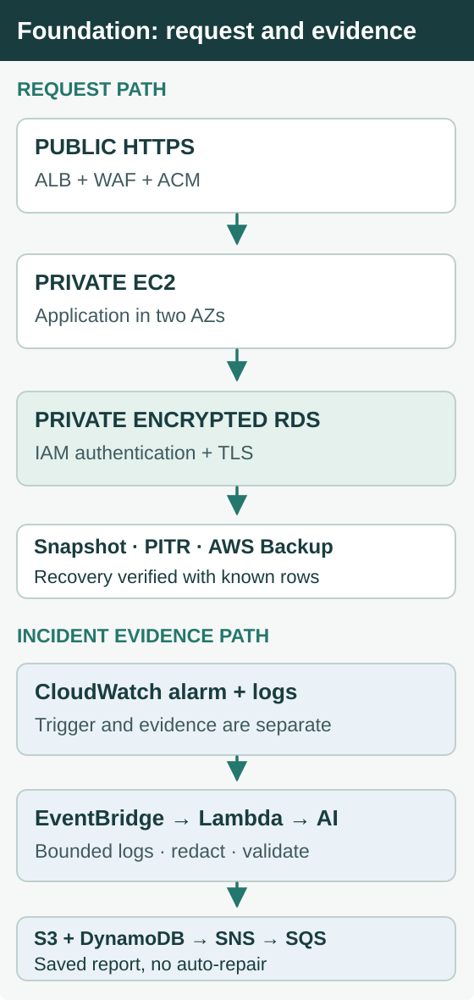

# Project 1 — Cloud Foundation

During the November 8 exercise, three recorded `/health` requests returned HTTP 503 before successful responses resumed. I had set the alarm state manually. The log errors were real, but neither the error codes nor the alarm transition established the root cause.

**Cloud Foundation makes those layers inspectable and makes recovery measurable.** I built a protected HTTPS entry point with private EC2 and encrypted RDS MySQL, then connected CloudWatch alarms to a Python investigator that collects bounded logs, separates observed evidence from an AI-generated assessment, and saves a report for the operator. I also restored database copies and checked for known records.

This is a non-production lab based on RSVP Society's earlier server-hosted design. The live business moved toward event-driven services for its bursty event traffic; no real guest data was used here.

## The foundation I built

The public entry point is an Application Load Balancer with AWS WAF and an ACM certificate. EC2 instances sit in private subnets across two Availability Zones, behind an Auto Scaling group. Encrypted Multi-AZ RDS MySQL stays private as well.

Each control answers a different question. A security group establishes which network paths are permitted. The EC2 role and IAM database authentication determine whether the application may read MySQL. Verified TLS protects that connection. **None of those settings alone proves the reservation API can return the expected rows**, so I validated that response separately.

[Network Terraform](terraform/vpc.tf) · [Database Terraform](terraform/rds.tf)

## AI incident analysis

An alarm reports that a threshold or state has changed. It does not tell the operator what failed. CloudWatch and EventBridge hand the event to a Python Lambda handler, which builds an investigation record rather than treating an AI summary as an answer.

When an alarm changes state, Lambda collects a five-minute window of application logs, limits and redacts the evidence, and asks AI for a structured explanation and recommended checks. It validates the response, stores the report in KMS-encrypted S3, indexes it in DynamoDB, and publishes its reference through SNS.

**The model proposes a diagnosis; it never changes infrastructure or closes the incident.** Failed log collection is recorded. If the model times out or returns invalid fields, the handler saves a low-confidence fallback based on the available alarm evidence.

### The November 8 investigation

I set the development ALB 5xx alarm to **ALARM** to exercise the handoff. That transition was operator-set, not a naturally triggered threshold event. The collected log window nevertheless included real HTTP 503 health checks followed by successful responses at 23:19:59 UTC.

Lambda collected **77 log entries**. The model suspected Apache could not connect to its local backend during the 503s, but the logs did **not** establish why the backend was unavailable. It recommended verifying the current health endpoint, the database-backed reservation API, and ALB target health before closing the investigation.

**The 503s are observed evidence; the suspected backend connection failure is not a proven root cause.** The handler caps collection at 120 entries, truncates messages, redacts sensitive content, validates confidence and required fields, and keeps the underlying event context for the operator.

The report was saved and indexed; SNS delivered the reference to an **encrypted SQS test subscriber**. Human email receipt was not tested. [Incident record](evidence/live-incident.json) · [Python handler](terraform/ai_log_summarizer.py)

## Live application and network validation

The Flask application read an operator-inserted marker from private MySQL using its EC2 role and a TLS-verified connection. In the integrated exercise, both the EC2 and later ECS HTTPS endpoints returned the same **three records**, proving that different private application paths could reach the same data.

The first EC2 rollout exposed a concrete startup fault: Gunicorn could not open the configured systemd stderr path. Correcting it restored service. CloudWatch recorded the load balancer's target-health transitions; the application screenshot captures the earlier two-row state before the recovery marker was inserted.

[Application readback](evidence/live-rds-reader.png) · [Networking and WAF evidence](evidence/2026-11-08.md)

## Recovery evidence

Investigation helps find the problem. Recovery must prove the data is there afterward, not merely that AWS marked a restore job complete.

| Recovery method | What I verified | Limit of the measurement |
| --- | --- | --- |
| Encrypted snapshot | Known row readable after **10m 02s** | Snapshot restore, not application failover |
| Point-in-time recovery | Checkpoint marker readable after **13m 50s**; later row absent | Demonstrates the chosen recovery point |
| AWS Backup | Restore job completed in **16m 48s**; row read separately afterward | Job timing is not data verification timing |
| Multi-AZ failover | RDS operation completed in **19.85s** | Client recovery has a separate timeline |

These mechanisms answer different questions: recover a database from a snapshot, restore to an earlier state, use an independent backup workflow, or fail over a highly available database instance. None of the measurements is an end-to-end application RTO.

[Timestamped recovery timeline](evidence/2026-11-08.md#recovery-timeline) · [Recovery observations](evidence/live-recovery.json) · [PITR readback](evidence/live-pitr.json)

## What the evidence establishes

The AWS exercises showed the permitted HTTPS-to-database path working, a deliberately raised alarm producing a saved investigation, and database restores returning expected records. They did **not** demonstrate autonomous remediation, naturally triggered 5xx alarm thresholds, or human email receipt.

The important boundary is between a signal and proof: observed errors are not automatically root causes, and database availability is not the same as recovered data.

## Why Project 2 followed

The next risk was a release that appeared healthy but served the wrong software. [Project 2 — ECS & CI/CD](../project-2-ecs-cicd/README.md) puts this same reservation service on private ECS tasks and verifies the revision returned over HTTPS, while preserving access to the Foundation database.

Original report excerpts and verification digest

The November 8 AI report was retained in encrypted S3. An authorized reader with the full report can verify its SHA-256 digest:

`53a5efd6d23b93dc24a7db25169caeaeee13ddf34e2dd8b924af2da3b8bfd69f`

**Observed log evidence:** Three `/health` requests returned HTTP 503 at 23:18:59, 23:19:29, and 23:19:32 UTC.

**Model assessment:** Health checks recovered to HTTP 200 by 23:19:59 UTC. The model described an Apache-to-local-backend connection refusal as a likely explanation, while acknowledging the evidence did not prove why the backend was unavailable.

**Recommended checks:** Verify whether the alarm was operator-set, then check current `/health`, `/api/reservations`, and target group status.

[Incident delivery](evidence/live-incident.json) · [Recovery evidence](evidence/live-recovery.json)

