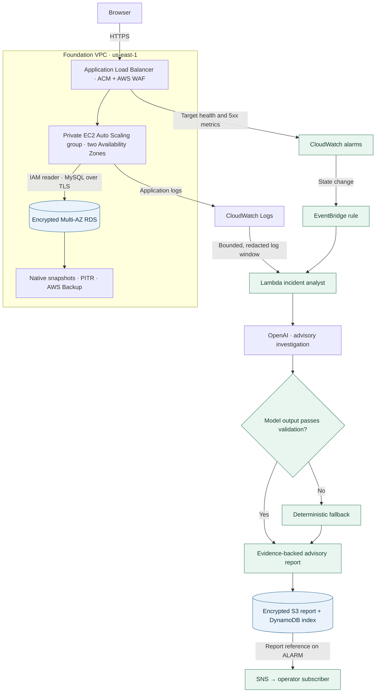

# Project 1 — Cloud Foundation

An HTTPS request crosses a protected public edge to a private application tier. When a health alarm changes state, the platform gathers evidence and sends an advisory report to the operator.



**Recovery benchmark:** the historical encrypted snapshot restore recovered a known database row in **10m 02s**. [Timestamped recovery timeline](evidence/2026-11-08.md#recovery-timeline)

## Live integration on November 8

The shared Flask application read an operator-inserted marker from private MySQL through the EC2 role and a TLS-verified IAM connection. Both HTTPS endpoints later returned the same three records. The EC2 screenshot captures the first two, before the recovery checkpoint marker was added. [Live foundation page](evidence/live-rds-reader.png) · [ECS read-back](../project-2-ecs-cicd/evidence/live-release-recovery.json)

On the first rollout, Gunicorn failed before startup because systemd could not open its stderr file. Correcting the log path restored the service. The real load-balancer metrics capture the target-health transitions.


### AI incident analysis

An operator set the development load balancer’s 5xx alarm to **ALARM**. From there the investigation ran automatically.

| Step | What happened in AWS |
|---|---|
| Trigger | EventBridge routed the alarm change to the incident Lambda. |
| Investigation | Lambda collected **77 log entries**. The model produced an advisory analysis. |
| Report | The pipeline saved the report in KMS-encrypted S3 storage and recorded the incident in DynamoDB. |
| Notification | SNS delivered the notification to an encrypted SQS test subscriber. Human email delivery remains unverified. |

[Supporting incident record](evidence/live-incident.json)

#### From the saved AI report

At 23:24 UTC the model identified two separate events. The operator had deliberately set the alarm. Earlier, Apache had returned 503 to load balancer health checks because its connection to the local application was refused. By 23:19:59 UTC, checks were returning 200. The logs supported a temporarily unavailable backend. They did not establish why the process stopped listening.

The report recommended comparing target health with Gunicorn and service-supervisor logs during the failure window, then checking the health endpoint and a database-backed request before closing the incident. SNS delivered the report reference to the exercise subscriber. An operator decides whether to restart a service, change configuration or close the incident.

*Sanitized summary of the stored model response from November 8 at 23:24:01 UTC.*

## Recovery evidence

AWS Backup completed a separate restore in 16m 48s. A later private TLS read confirmed the expected row. RDS also reported a Multi-AZ failover start and completion 19.85 seconds apart. [AWS recovery evidence](evidence/live-recovery.json)

The [point-in-time recovery readback](evidence/live-pitr.json) records a TLS query against the private, encrypted restored database. The expected rehearsal row was readable 13m 50s after the restore request.

[Earlier networking, WAF and recovery exercise](evidence/2026-11-08.md)

## Operations

**Location:** `project-1-cloud-foundation/terraform/`

### Portfolio-dev configuration

Use `environments/portfolio-dev/`, not the older `dev/` backend. The portfolio prefix is `rsvp-pf1-dev`, and the state key is `project-1-cloud-platform/portfolio-dev/terraform.tfstate`. The proposed VPC CIDR is `10.83.0.0/16`; confirm it does not conflict with networks the VPC may connect to.

Prepare local copies of `backend.hcl.example` and `terraform.tfvars.example`, leaving the examples untouched. Set the delegated child-zone ID, `dev.cloud.rsvpsociety.com`, and a **dedicated** Secrets Manager ARN for the AI credential. Keep these values out of Git.

After filling in and checking those local files:

```sh
cd project-1-cloud-foundation/terraform
export TF_DATA_DIR="$PWD/.terraform/portfolio-dev"
terraform init -backend-config=environments/portfolio-dev/backend.hcl
terraform workspace show
terraform plan -var-file=environments/portfolio-dev/terraform.tfvars -out=portfolio-dev.tfplan
```

To check the intended first-deployment scope, review the plan and run the local reviewer with the independently confirmed child-zone ID:

```sh
set -o pipefail
terraform show -json portfolio-dev.tfplan | python3 ../../shared/review-portfolio-plan.py p1 "$CHILD_ZONE_ID"
```

A scope finding means **stop and review**, not override the check. Keep plans and raw state private; they may contain sensitive values.

Only after an explicit approval should anyone apply the reviewed plan.

**What to verify:** HTTPS health; two healthy private instances in different AZs; WAF response; application and VPC logs; a working app-to-database request; alarm-to-AI delivery and saved report; RDS encryption and managed credentials; AWS Backup recovery, point-in-time restore, and a controlled failover. Record observed results separately from configuration checks.

The historical EC2 page and the database marker were tested separately. An application-to-database claim requires a request that returns a row from RDS.


The plan reviewer is intended for first-deployment scope checks, not automatic approval of updates or deletions. It may return exit 1 for scope/action findings and exit 2 for invalid input. Keep the JSON stream out of saved logs; review IAM, budget, backend identity, shared dependencies, and ACM DNS record ownership separately.

[Platform overview](../README.md) · [Shared state, DNS, costs and teardown](../shared/OPERATIONS.md)
