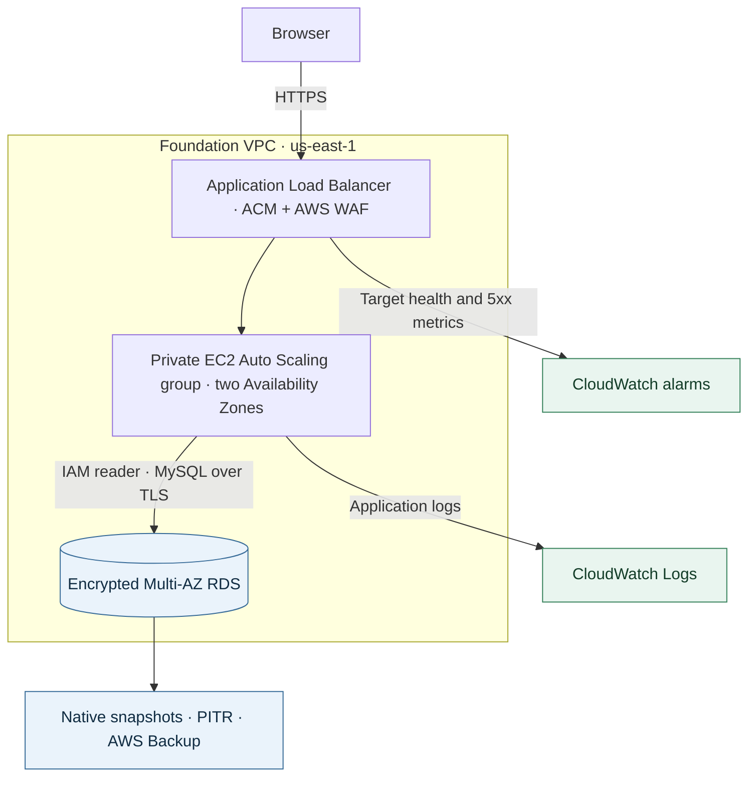
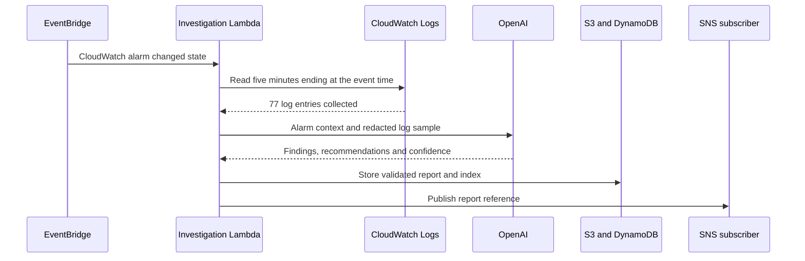

# Project 1 — Cloud Foundation

A guest sees a failed page. From the network side, that could mean a blocked path, an unhealthy server or an application that accepted the connection and then failed. I wanted a public service with a small exposed surface and enough evidence to tell those cases apart.

Only the load balancer accepts public web traffic. A web application firewall filters requests there, and the load balancer checks private EC2 servers in two Availability Zones. The application uses its AWS role to authenticate to MySQL over an encrypted connection. That keeps the database off the public network while giving the application the limited access it needs.

**Recovery benchmark:** the historical encrypted snapshot restore recovered a known database row in **10m 02s**. [Timestamped recovery timeline](evidence/2026-11-08.md#recovery-timeline)

## Live integration on November 8

The shared Flask application read an operator-inserted marker from private MySQL through the EC2 role and a TLS-verified IAM connection. Both HTTPS endpoints later returned the same three records. The EC2 screenshot captures the first two, before the recovery checkpoint marker was added. [Live foundation page](evidence/live-rds-reader.png)

On the first rollout, Gunicorn failed before startup because systemd could not open its stderr file. Correcting the log path restored the service. The real load-balancer metrics capture the target-health transitions.

### AI incident analysis

I set the development load balancer’s 5xx alarm (`rsvp-pf1-dev-target-5xx-high`) to **ALARM** to exercise the handoff an on-call engineer would receive. The metric alarm supplied the signal. Its state, reason and timestamp gave the investigator a place to start looking in the application logs.

The Python handler caps each investigation at 120 entries and truncates each message before redaction. It checks the model’s output fields and confidence value. If log collection fails, the record carries the collection error. If analysis times out or the response fails validation, the handler produces a low-confidence fallback with the captured alarm context. An operator can see when the evidence is incomplete.

In this run the response passed validation. The report was saved in KMS-encrypted S3 storage and indexed in DynamoDB. SNS delivered its reference to an encrypted SQS test subscriber. Human email delivery was outside the exercise.

#### From the saved AI report

At 23:24:01 UTC on November 8 the analyst recorded the following excerpts from the 77-entry investigation. All six excerpts below were checked against the original report in encrypted S3 storage. The repository contains the excerpts and execution record. An authorized reader with the full report can verify its SHA-256 digest: `53a5efd6d23b93dc24a7db25169caeaeee13ddf34e2dd8b924af2da3b8bfd69f`.

**Observed in the logs** (report field `evidence_used`):

> At 23:18:59, /health returned 503 to ELB-HealthChecker/2.0.
>
> Additional /health 503 responses occurred at 23:19:29 and 23:19:32.

**Model assessment** (from `summary` and `likely_root_cause`):

> Health checks recovered to HTTP 200 by 23:19:59 and remained healthy through the end of the supplied logs, including after later Gunicorn/Apache startup messages.
>
> Separately, the observed earlier 503s were likely caused by Apache proxy failures to connect to the local backend service on 127.0.0.1:8080, consistent with the backend not listening or restarting at that time. The supplied evidence does not prove why the backend was unavailable.

**Recommended checks** (from `recommended_checks`):

> Confirm in CloudWatch alarm history whether the ALARM transition was operator-set rather than metric-driven.
>
> Verify current /health, /api/reservations, and target group status remain healthy before closing the incident.

The operator had set the alarm to exercise the notification path. The earlier 503s were real observations within the collected window. Restarting the service, changing configuration and closing the incident remained operator decisions.

## Recovery evidence

| Recovery mechanism | Evidence and timing |
|---|---|
| Encrypted snapshot | Queried a known row in the restored database after **10m 02s**. |
| Point-in-time recovery | A private TLS read returned the rehearsal marker after **13m 50s**. The row added after the chosen checkpoint was absent. |
| AWS Backup | The restore job completed in **16m 48s**. A later TLS query independently verified the row. |
| Multi-AZ failover | RDS reported **19.85s** between failover start and completion. This measures the database operation; client recovery has a separate timeline. |

[Earlier networking, WAF and recovery exercise](evidence/2026-11-08.md)

The alarm handler bounds and redacts its log sample before requesting analysis. The Terraform configuration defines the access path and database recovery settings. [Investigation handler](terraform/ai_log_summarizer.py) · [Network boundaries](terraform/vpc.tf) · [Database configuration](terraform/rds.tf)

Technical evidence records

[Incident delivery](evidence/live-incident.json) · [Recovery observations](evidence/live-recovery.json) · [Point-in-time readback](evidence/live-pitr.json)

