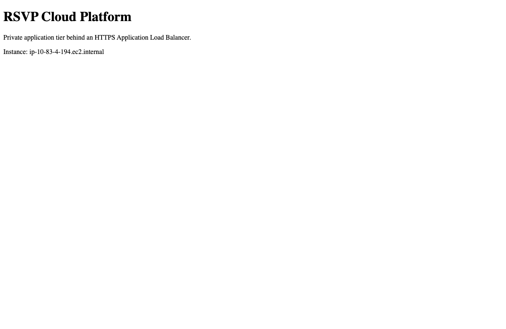

# Part 1 — Cloud Foundation

**The infrastructure baseline: secure traffic paths, private workloads, monitoring, and data recovery.**

I started with the kind of AWS design I would expect to encounter in a traditional enterprise environment: a public entry point, private application servers, and a private database. The goal was not just to make the page load. It was to understand what happens when an instance becomes unhealthy, a request is blocked, or data needs to be recovered.

```text
Internet
   |
HTTPS load balancer + AWS WAF
   |
Private EC2 targets (two Availability Zones)
   |
Private, encrypted Multi-AZ RDS
```

## Engineering choices

**Network boundaries.** The load balancer accepts public HTTPS traffic; the application and database don't require public addresses. Security groups control which tier can communicate with the next. The VPC, subnets, and routing are defined in Terraform.

**Availability and visibility.** Application targets run across Availability Zones. CloudWatch, VPC Flow Logs, application logs, and alarms expose what the platform is doing rather than leaving failures hidden.

**Data protection.** RDS uses encrypted storage, managed credentials, snapshots, and backup configuration. Recovery depends on keeping the database encryption key available; that key has a Terraform destruction guard. I tested one snapshot restore—not every possible recovery method.

**Incident analysis.** A CloudWatch alarm can feed bounded evidence into a Lambda-based analyzer, which stores a structured result in encrypted storage. AI is advisory, with a deterministic fallback. It does not make infrastructure changes.

The trade-off is cost. Multiple Availability Zones, a database, NAT gateways, and monitoring are reasonable controls for some workloads, but they were excessive as the everyday architecture for RSVP Society.

## What I verified in AWS



On November 8, 2026, the environment demonstrated:

- Two healthy private application targets in different Availability Zones.
- Working HTTPS and a WAF response blocking a harmless test request.
- CloudWatch alarm activity and application/network logging.
- An encrypted RDS snapshot restored to a separate database; a known test record was read back in **10 minutes 2 seconds**.
- A directly invoked incident-analysis Lambda producing an encrypted, stored fallback result. A separate local handler test produced an AI result.

The browser page and the database record were tested separately. That exercise **did not** demonstrate an application request reading from RDS. Automatic alarm-to-Lambda delivery, point-in-time recovery, and AZ failover were not measured.

[Full dated findings and recovery timeline](evidence/2026-11-08.md) · [Recorded observations](evidence/observations.json)

This part established the security, observability, and recovery principles that shaped the next part of the platform.

[Back to the full platform](../README.md) · [Part 2: ECS & CI/CD](../project-2-ecs-cicd/README.md)
