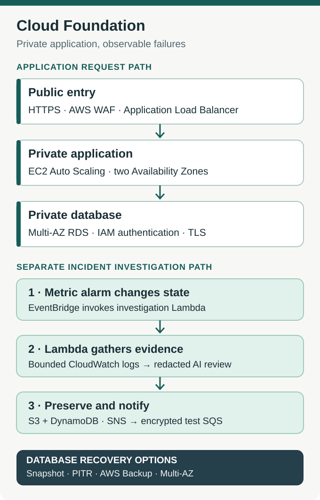

# Project 1 — Cloud Foundation and Incident Investigation

A failed web request doesn't tell an engineer where the fault is. The public endpoint might be unreachable, the load balancer might have no healthy targets, the application might fail after accepting the connection, or the database might be unavailable. Treating all four as the same incident sends troubleshooting in the wrong direction.

**I built a private, highly available AWS application environment and an automated investigation path to make those failures easier to distinguish.** The application is a small read-only reservation service from the [RSVP Cloud Platform lab](../README.md), based on the earlier architecture for RSVP Society. It gave me a real database-backed request to test instead of relying on a synthetic health endpoint alone.

## What I built

The foundation has three connected parts:

- **A protected application path.** AWS WAF and an HTTPS Application Load Balancer face the internet. EC2 instances run in private subnets across two Availability Zones. They read an encrypted Multi-AZ MySQL database through TLS and IAM database authentication.
- **An investigation path.** CloudWatch alarms and EventBridge trigger a Python Lambda. It collects a bounded log window, redacts evidence, asks a language model for an assessment, validates the response and keeps a fallback when analysis fails. Reports are written to KMS-encrypted S3 and indexed in DynamoDB; SNS publishes a report reference.
- **A recovery path.** Encrypted snapshots, RDS point-in-time recovery, AWS Backup and Multi-AZ failover provide different ways to restore or maintain database service. I tested them separately because each answers a different recovery question.

The network path and investigation path are intentionally separate. **A CloudWatch metric-alarm state change triggers the investigation; application logs are evidence Lambda collects afterward.**

## Key engineering decisions

### Private access must still be provable

The load balancer is public; the application servers and database are not. Security groups restrict the next hop, and the EC2 role grants narrowly scoped database access. The MySQL connection verifies TLS rather than relying on network placement as proof of trust.

This also gives an incident investigator meaningful checkpoints: external HTTPS response, ALB target health, application logs and a database-backed read. A successful `/health` alone cannot prove that a reservation query works. [VPC and security boundaries](terraform/vpc.tf) · [Database and IAM configuration](terraform/rds.tf)

### AI assesses evidence; it does not control repair

The model receives alarm context and a redacted log sample, not unrestricted access to the environment. The handler caps the collection at **120 entries**, bounds individual messages and checks the returned fields and confidence. Missing logs, timeouts or invalid model responses produce a low-confidence fallback instead of silently dropping the incident.

That is the same separation used during manual escalation: observations are evidence, a proposed root cause is a hypothesis, and an operator decides what to change. The Lambda **does not restart instances, change security groups or close incidents**. [Investigation handler](terraform/ai_log_summarizer.py)

### Recovery has to end with a usable row

A backup marked `AVAILABLE` is not the same as recovered application data. My restore checks used a known record and a private TLS query. I also distinguished the database's reported failover duration from the time an application client could reconnect.

That distinction matters because snapshot restore, point-in-time recovery, AWS Backup and Multi-AZ failover solve different problems. None of their measured times is a guaranteed production RTO.

## What I verified in AWS

### The application and network path

The lab served HTTPS through the ALB to private instances in two Availability Zones. A WAF test request was blocked with HTTP 403. The application used its instance role to read an operator-inserted reservation marker from private RDS. In the later integrated exercise, the EC2 and ECS versions returned the **same three records** over separate private network paths.

The initial EC2 deployment also exposed a real startup failure: Gunicorn could not open its configured stderr file, so the target failed health checks. Fixing the log path restored service. The chart below records those target-health transitions; it is **not** evidence of a naturally triggered AI incident.

[Live EC2 database read](evidence/live-rds-reader.png) · [Initial network, WAF and availability-zone observations](evidence/2026-11-08.md)

### AI-assisted investigation

I deliberately set the **development** 5xx CloudWatch alarm to `ALARM` to exercise the real EventBridge → Lambda → AI → storage → SNS path. Lambda collected **77 log entries** from the event-time window. Those logs included genuine earlier HTTP 503 health-check responses, followed by successful responses.

The model assessed refused connections between Apache and its local backend as the **likely** explanation for the earlier 503s. The records did not prove why the backend was unavailable. Its suggested closing checks covered the public `/health` response, the database-backed `/api/reservations` route and current target-group health.

The response passed validation. Its report was saved in KMS-encrypted S3, indexed in DynamoDB, and the report reference reached an **encrypted SQS test subscriber** through SNS. No human email receipt or automatic remediation was tested.

[Incident delivery record](evidence/live-incident.json) · [Investigation workflow](terraform/ai-logs.tf)

### Database recovery

Each exercise used a different success criterion:

- **Encrypted snapshot — 10m 02s:** from restore request to reading the expected row over a private TLS connection.
- **Point-in-time recovery — 13m 50s:** the restored database contained the checkpoint record but excluded a row committed after the selected point.
- **AWS Backup — 16m 48s:** the restore job completed; a separate later database query verified the row.
- **Multi-AZ failover — 19.85s:** RDS-reported failover start to finish. Client reconnection and application recovery are separate measurements.

[Timestamped recovery timeline](evidence/2026-11-08.md#recovery-timeline) · [Integrated recovery record](evidence/live-recovery.json) · [PITR readback](evidence/live-pitr.json) · [Backup configuration](terraform/backup.tf)

## Validation boundaries and implementation

The first foundation exercise verified real networking, WAF behavior, database reads and a deterministic incident fallback. The later integrated exercise verified the alarm-to-Lambda delivery and a valid AI response. Those observations should not be conflated into one uninterrupted incident.

All tests ran in an isolated development environment. The trigger for the AI run was **operator-set**, and its likely cause remains an inference. The original application and the live infrastructure have since been retired; retained snapshots, keys and evidence storage can still cost money.

The infrastructure lives in [Terraform](terraform/), with [infrastructure tests](tests/test_foundation_infrastructure.py) and [RDS recovery verification](validate-rds-recovery.sh). For the other side of the shared private database, see [Project 2 — ECS Delivery](../project-2-ecs-cicd/README.md).
