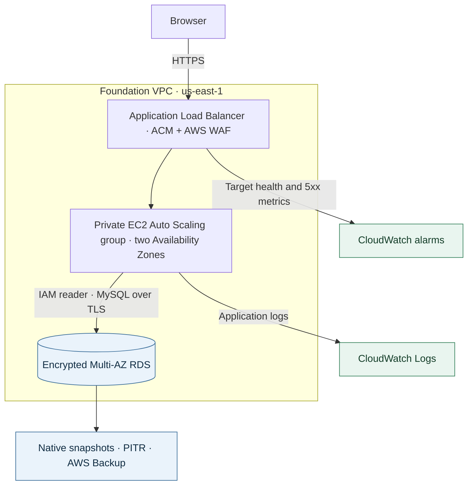

# Project 1 — Cloud Foundation

An HTTPS request crosses a protected public edge to a private application tier. When a health alarm changes state, the platform gathers evidence and sends an advisory report to the operator.

**Recovery benchmark:** the historical encrypted snapshot restore recovered a known database row in **10m 02s**. [Timestamped recovery timeline](evidence/2026-11-08.md#recovery-timeline)

## Live integration on November 8

The shared Flask application read an operator-inserted marker from private MySQL through the EC2 role and a TLS-verified IAM connection. Both HTTPS endpoints later returned the same three records. The EC2 screenshot captures the first two, before the recovery checkpoint marker was added. [Live foundation page](evidence/live-rds-reader.png)

On the first rollout, Gunicorn failed before startup because systemd could not open its stderr file. Correcting the log path restored the service. The real load-balancer metrics capture the target-health transitions.

### AI incident analysis

An operator set the CloudWatch alarm `rsvp-pf1-dev-target-5xx-high` to **ALARM**. From there the investigation ran automatically.

| Step | What happened in AWS |
|---|---|
| Trigger | EventBridge routed the alarm change to the incident Lambda. |
| Investigation | Lambda collected **77 log entries**. OpenAI returned an advisory analysis. |
| Report | The pipeline saved the report in KMS-encrypted S3 storage and recorded the incident in DynamoDB. |
| Notification | SNS delivered the notification to an encrypted SQS test subscriber. Human email delivery remains unverified. |

#### From the saved AI report

At 23:24 UTC the model identified two separate events. The operator had deliberately set the alarm. Earlier, Apache had returned 503 to load balancer health checks because its connection to the local application was refused. By 23:19:59 UTC, checks were returning 200. The logs supported a temporarily unavailable backend. They did not establish why the process stopped listening.

The report recommended comparing target health with Gunicorn and service-supervisor logs during the failure window, then checking the health endpoint and a database-backed request before closing the incident. SNS delivered the report reference to the exercise subscriber. An operator decides whether to restart a service, change configuration or close the incident.

Two checks from the generated report:

> Confirm in CloudWatch alarm history whether the ALARM transition was operator-set rather than metric-driven.
>
> Verify current /health, /api/reservations, and target group status remain healthy before closing the incident.

*Sanitized summary of the stored model response from November 8 at 23:24:01 UTC.*

## Recovery evidence

AWS Backup completed a separate restore in 16m 48s. A later private TLS read confirmed the expected row. RDS also reported a Multi-AZ failover start and completion 19.85 seconds apart.

The point-in-time recovery readback records a TLS query against the private, encrypted restored database. The expected rehearsal row was readable 13m 50s after the restore request.

[Earlier networking, WAF and recovery exercise](evidence/2026-11-08.md)

The alarm handler bounds and redacts its log sample before requesting analysis. The Terraform configuration defines the access path and database recovery settings. [Investigation handler](terraform/ai_log_summarizer.py) · [Network boundaries](terraform/vpc.tf) · [Database configuration](terraform/rds.tf)

Technical evidence records

[Incident delivery](evidence/live-incident.json) · [Recovery observations](evidence/live-recovery.json) · [Point-in-time readback](evidence/live-pitr.json)

