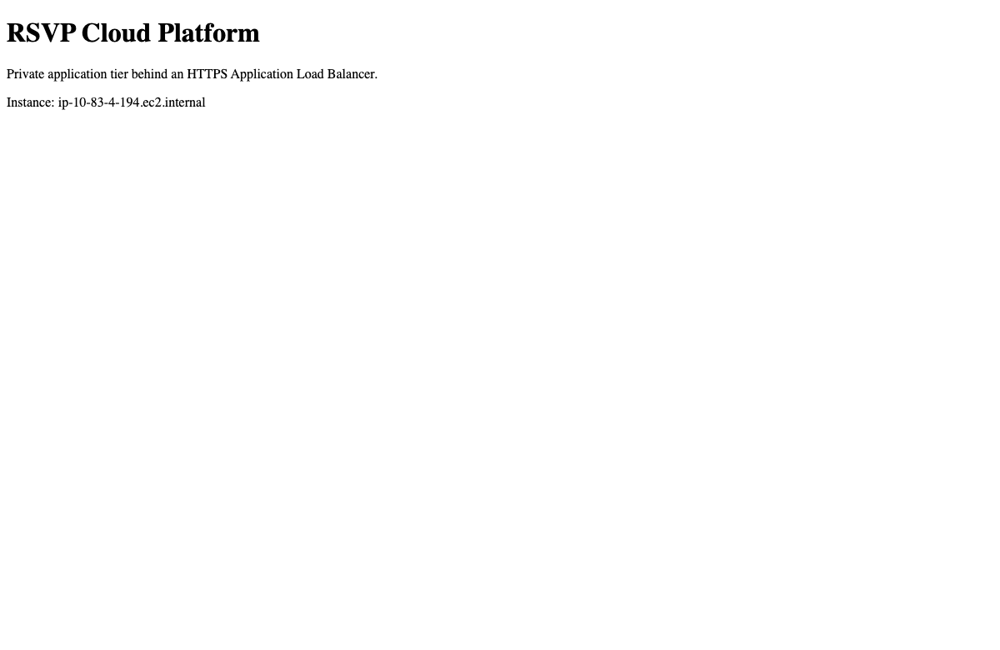

# Project 1 live exercise, November 8, 2026

I exercised the isolated portfolio-dev stack in us-east-1. All times below are Eastern Standard Time. The original rsvp-dev ASG and Society production were outside the exercise.

| Claim | Observation |
|---|---|
| Private service across AZs | The target group reported two healthy instance IDs. EC2 placed those same instances in us-east-1a and us-east-1b with private IPs and no public addresses. The first targets initially failed health checks and drained. |
| HTTPS and application serving | ACM reported ISSUED with successful domain validation for dev.cloud.rsvpsociety.com. The live health route returned HTTP 200 and ok. A browser loaded the application landing page. |
| WAF and observability | A harmless synthetic XSS query returned HTTP 403. The regional web ACL was associated with the ALB. VPC Flow Logs reported ACTIVE/SUCCESS for ALL traffic. Apache access and error streams appeared in CloudWatch. The unhealthy-target alarm entered ALARM at 00:14:27 and returned to OK at 00:20:27. |
| Encrypted data and recovery | RDS reported MultiAZ=true, StorageEncrypted=true, backup retention of 14 days and an active managed master secret. The primary and restore used private networking. |
| Deterministic incident analysis | I directly invoked the deployed Lambda with a synthetic alarm and an empty portfolio secret. The initial invocation failed on DynamoDB KMS decryption. With decrypt scoped to the demo key, DynamoDB service and table encryption context, the retry returned fallback. A consistent table read confirmed the record and S3 confirmed a 5,381-byte KMS-encrypted summary. No external model result was produced. |

## Captured evidence

The screenshot shows the page served by a private demo instance. Its internal hostname is visible. The [live observations](observations.json) include the two target health results, AZs, TLS certificate status, WAF probe, alarm transitions, recovery timestamps and persisted fallback result.

## Recovery timeline

| Time | Observed milestone |
|---|---|
| 00:34:36 | Inserted, committed and read the synthetic marker on the source database through SSM with certificate and hostname verification. |
| 00:34:40 | Requested a native RDS snapshot. |
| 00:37:19 | Observed the encrypted source snapshot available. |
| 00:38:02 | Requested a private, single-AZ disposable restore. The first request using managed-password creation was rejected by the MySQL restore API. The successful request used the snapshot credential. |
| 00:48:04 | Read the exact marker from the restored instance over TLS_AES_256_GCM_SHA384. |

Restore request to successful row read took approximately **10 minutes 2 seconds**. This measures one snapshot restore with 20 GiB provisioned and a tiny test dataset. Application cutover, point-in-time recovery, scheduled AWS Backup restore and AZ failover remain unmeasured.

## Operational findings

- The planned db.t3.micro class cannot provide Performance Insights for this MySQL configuration. The demo used db.t4g.medium. The AWS price catalog returned $0.129/hour Multi-AZ and $0.065/hour Single-AZ for instance capacity, before storage and Extended Support.
- The account reported 10 total and 10 unreserved Lambda executions. AWS rejected the requested reservation of two. The original apply was partial. Subsequent scoped plans created the supported database and backup selection and updated only the demo Lambda policy. Alarm-to-Lambda delivery remains unverified. Account concurrency settings were preserved.
- The independent AWS Backup vault had no recovery points during the exercise. The retained native RDS snapshot supplied the verified recovery path.

## Cleanup and continuing charges

At 00:59 EST, independent service queries returned zero portfolio EC2 instances in active or stopped states, ASGs, ALBs, active NAT gateways, allocated demo EIPs, demo VPCs or DB instances. The source and disposable restore were both gone. The child hosted zone retained its NS and SOA. The two encrypted manual snapshots were available, and RDS reported retained automated backups for both databases.

The exercise ran for about 49 minutes from initial provisioning to final verification. The corrected running estimate is approximately $0.72/hour for a fully provisioned stack, plus roughly $0.27/hour for a disposable restore. Minimum billing increments, usage and retained assets affect the invoice. These are planning estimates. Actual charges require a later billing report.

The shared backend, four portfolio encryption keys, backup vault, retained logs, two evidence/log buckets, DynamoDB metadata, portfolio secret, delegated hosted zone and snapshots remain. Keep the corresponding decryption keys until retention decisions are made. The manual proof and final snapshots require an explicit expiry decision. Budget roughly $4/month for the four demo keys before rotations/requests, plus the shared backend key, hosted zone, secret and usage-based storage and requests.

## Focused model test after teardown

At 01:05 EST, I ran the Project 1 handler locally with one synthetic alarm and zero log messages. The live gpt-5.5 response passed the handler schema checks. I verified ai_generated in DynamoDB and in the KMS-encrypted S3 record. Automatic alarm delivery to Lambda remains unverified.
