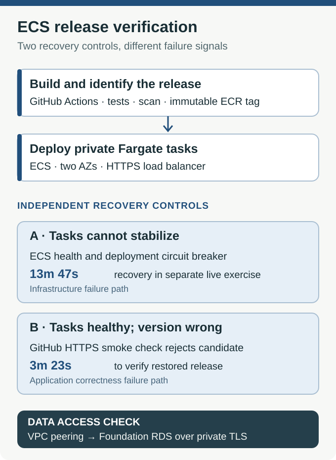

# Project 2 — ECS Delivery and Automated Recovery

An application can pass its infrastructure health checks and still serve the wrong release. ECS may report healthy tasks because the process answers `/health`, while customers are receiving an outdated version—or a release that cannot read its database.

**I built an AWS container delivery pipeline that checks what the application actually serves, not just whether its containers are running.** It reuses the reservation service and private RDS database from [Project 1](../project-1-cloud-foundation/README.md), but runs the application on ECS Fargate in a second private VPC.

The central design decision is to keep **infrastructure recovery** and **release correctness** independent. Each catches failures the other can miss.

## What I built

- **Container runtime:** Private ECS Fargate tasks in two Availability Zones, an HTTPS Application Load Balancer, WAF, CloudWatch monitoring, autoscaling and immutable images stored in ECR.
- **Controlled deployment:** GitHub Actions runs tests and image scanning, obtains temporary AWS credentials through OIDC, publishes an image tagged with its Git revision, deploys it and checks the actual HTTPS response.
- **Two recovery controls:** ECS's deployment circuit breaker handles unhealthy tasks. The workflow can separately reject a stable task serving the wrong version and restore the prior task definition.
- **Private database access:** VPC peering, return routes, scoped security groups and IAM-authenticated TLS let the Fargate tasks read the foundation's RDS database without making it public.

## Key engineering decisions

### Task health and software correctness are different signals

ECS can tell whether a task becomes healthy. It cannot establish that the right Git revision is serving over the customer-facing endpoint. The deployment workflow therefore tests **health, environment and serving version**, and confirms the restored version after a failed release.

This is the same reason a network engineer distinguishes a responsive host from a functioning service: a positive result at one layer does not prove the next layer is correct.

The two recovery controls were tested **separately**, and their reported durations start from different failure signals. [Controlled-deploy workflow](../.github/workflows/ecs-project2-deploy.yml)

### Prove the artifact running in private tasks

A moving image tag makes it difficult to establish exactly what was deployed. The build uses an immutable Git-SHA tag, and I compared the registry's digest with the digests reported by both private tasks.

GitHub Actions uses an environment-bound OIDC identity to assume a scoped AWS role instead of storing long-lived deployment keys. That AWS trust policy is **not a substitute** for branch/tag restrictions or reviewer approvals in GitHub Environments. [OIDC role and registry bootstrap](bootstrap-delivery/main.tf)

### Deployment ownership must not fight Terraform

Terraform owns the ECS infrastructure baseline; GitHub Actions promotes application task revisions. Otherwise, a later Terraform apply could unintentionally move the service backward or override a workflow release.

The workflow clones the baseline task definition, changes the image and deploys a new revision. After a Terraform change to the baseline, a controlled deployment is needed to promote that revision deliberately. [ECS configuration](terraform/ecs.tf) · [Service configuration](terraform/ecs_service.tf)

### A successful release must be able to read data

The original live rollback checked health and version. After the AWS lab was retired, I strengthened the workflow to check `/api/reservations` as well. A fixture-backed revision must return its expected seed; an RDS-backed revision must return an operator-owned marker that isn't present in the fixture. Rollback verifies the *restored revision's* expected backend, not the failed candidate's configuration.

This prevents a release from passing merely because a static health page works. **These newer database-aware checks were tested with simulated workflow responses, not a second live ECS/RDS deployment.** [Reservation verifier](verify-reservations.py) · [Candidate and rollback tests](tests/test_project2_release_health.py)

## What I verified in AWS

### Live release and recovery

In a controlled dev exercise, the candidate answered HTTPS health requests but exposed the deliberately wrong version. GitHub Actions rejected it and restored the previous task definition:

- **23:34:10 UTC:** the workflow rejected the version-mismatched candidate.
- **23:37:34 UTC:** the previous release was verified again.
- **3m 23s:** recorded recovery duration in the exercise.

In a separate drill, ECS detected tasks that could not stabilize and recovered the previously healthy revision in **13m 47s**. Neither number measures general deployment availability or guaranteed production recovery time.

[Rejected GitHub Actions run](https://github.com/JNHolman/RSVP-Cloud-Platform/actions/runs/42535446228) · [Live recovery record](evidence/live-release-recovery.json) · [Circuit-breaker timeline](evidence/2026-11-08.md)

### Private database reachability

The foundation EC2 application and delivery Fargate application returned the **same three reservation rows** from private RDS. I verified the tasks had no public IPs, and their image digests matched the ECR artifact.

The peering connection and return routes established network reachability; the task role and database permissions established authorization. Neither check alone was sufficient. [Peering and reader access](terraform/foundation-db.tf) · [Live database-backed application](evidence/live-rds-reader.png)

### Capacity and image security

I sent **1,625 requests** with a temporary 10% CPU target to exercise scaling. ECS desired capacity rose, then running capacity increased from **two tasks to three**. I did not observe a confirmed scale-in.

The original Bookworm-based image had **nine HIGH** findings in ECR. Rebuilding the same application on Trixie reduced the recorded HIGH count to **two**, both glibc findings (CVE-2026-5435 and CVE-2026-19499). This is a scan result, not proof that either vulnerability is exploitable or that the candidate is risk-free. The Trivy gate rejects qualifying HIGH/CRITICAL findings with known fixes; Checkov infrastructure findings are advisory. [Image comparison and remaining findings](evidence/2026-11-08.md#post-demo-image-remediation)

## What was not demonstrated

The live AWS rollback verified **serving version and health**; the later database-aware candidate and rollback checks have **simulated test coverage only** because the ECS/RDS lab was retired. Scale-in was not confirmed. The development exercises did not validate a protected production deployment.

At inspection on November 9, 2026, the repository's GitHub `prod` Environment returned `deployment_branch_policy: null` and `protection_rules: []`. Its environment-level branch/tag restrictions and reviewer gate were therefore absent; the AWS role's OIDC trust restriction alone did not supply those controls. [Environment settings response](https://api.github.com/repos/JNHolman/RSVP-Cloud-Platform/environments/prod)

The live runtime has been shut down to avoid continuing infrastructure charges. This repository retains the workflow, Terraform, tests and evidence—not a continuously running demo.

## Inspect the implementation

[Deployment workflow](../.github/workflows/ecs-project2-deploy.yml) · [Application and tests](app/) · [Release-health check](verify-release-health.py) · [Reservation check](verify-reservations.py) · [Infrastructure Terraform](terraform/) · [Earlier live evidence](evidence/2026-11-08.md)

The next project addresses a different question: [who may change the rules or audit records around these workloads?](../project-3-cloud-governance/README.md)
