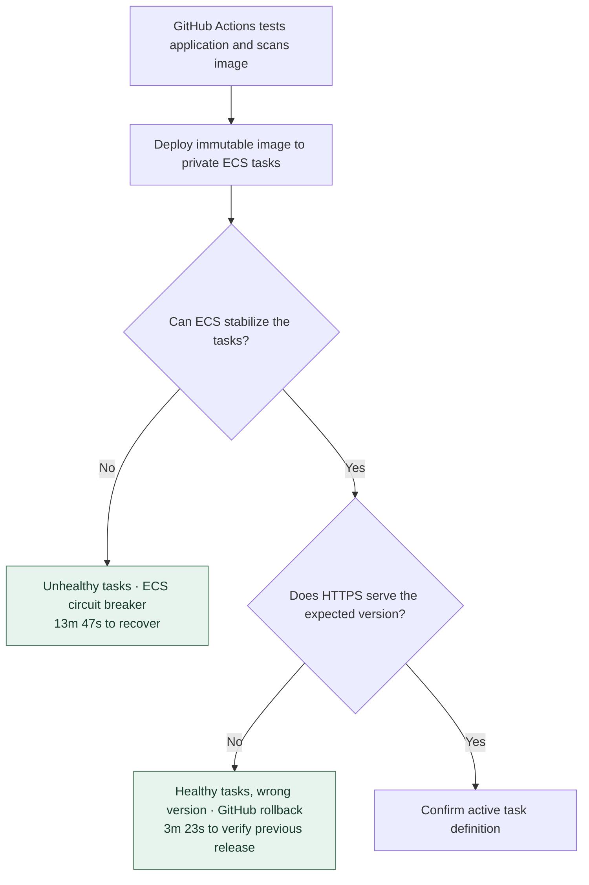
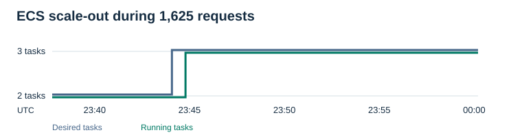

# Project 2 — ECS & CI/CD

A healthy container can still serve the wrong software. I used two independent checks in the dev release. ECS monitored task health. GitHub Actions checked the version that clients actually received over HTTPS.

I moved the foundation application onto managed containers so a release could be identified, repeated and reversed. GitHub Actions exchanged its workflow identity (OIDC) for temporary AWS credentials. The build tagged the container image with its Git revision in the ECR registry. Immutable tags kept a later build from silently taking the same name. I could compare the digest in the registry with the image running on both private Fargate tasks, and inspect the Trivy and ECR scan results for that build. [Build run](https://github.com/JNHolman/RSVP-Cloud-Platform/actions/runs/42534475017) · [Successful release](https://github.com/JNHolman/RSVP-Cloud-Platform/actions/runs/42535097319) · [Serving application](evidence/live-rds-reader.png)

## Live integrated release on November 8

**Live AWS results.** GitHub Actions detected a healthy endpoint serving the wrong version and verified rollback in **3m 23s**. In a separate exercise, ECS recovered an unhealthy deployment in **13m 47s**. The EC2 and ECS applications also returned the same three rows from private RDS.

**Simulated workflow tests.** The database-aware checks were added after those exercises. Tests cover accepting or rejecting a candidate and verifying the restored revision against its expected database. The AWS runtime had already been retired.

| GitHub Actions step | Recorded result | Why it matters |
|---|---|---|
| Smoke test · 23:34:10 UTC | “Unexpected release health, version or environment” | The candidate answered health requests but served the deliberately incorrect version. |
| Roll back failed deployment · 23:37:34 UTC | “Previous release verified after rollback” | The workflow restored revision 6 and verified the prior serving version, `43ef326`, in **3m 23s**. |

### Two ways to reject a release

The failed status on the [version-mismatch run](https://github.com/JNHolman/RSVP-Cloud-Platform/actions/runs/42535446228) records the rejected candidate. The public endpoint answered, so task health alone would have accepted it. In the separate **13m 47s** circuit-breaker drill, ECS itself detected the unhealthy revision. The clocks start at different failure signals. [Circuit-breaker timeline](evidence/2026-11-08.md)

### Capacity under load

I sent 1,625 requests with a temporary 10% CPU target. The chart distinguishes the scheduler asking for more capacity from another task actually running. Desired capacity rose first, then a third task reached running state. Observation ended before scale-in was confirmed.

**Task-definition ownership.** Terraform tagged the infrastructure baseline `ConfigurationSource=TerraformBaseline`. The release workflow cloned it and selected the image. That separation explains why, after any Terraform change that modifies the ECS task definition, operators run **Controlled Deploy** to promote the updated baseline. The exercises used dev. The AWS deployment role’s OIDC trust checks the repository and environment identity. GitHub Environment protection rules for `prod` must be configured separately to restrict deployment branches/tags. On November 9, 2026, the repository environment API returned `deployment_branch_policy: null` and `protection_rules: []`. The production authorization boundary therefore had no environment-level branch/tag restriction or reviewer gate at inspection. [Role trust policy](bootstrap-delivery/main.tf) · [Environment API](https://api.github.com/repos/JNHolman/RSVP-Cloud-Platform/environments/prod)

## Crossing the network boundary

The container release had its own private network. Giving the database a public endpoint would have bypassed the boundary I wanted to exercise. Instead, I connected the two networks through VPC peering with a return route, limited MySQL access to the task security group, and scoped its role to the database reader. Network reachability and permission to read a row were separate checks.

| Private database path | Observed result |
|---|---|
| Foundation EC2 in the database VPC | The instance role read the rehearsal data through a TLS-verified MySQL connection. |
| Fargate in the delivery VPC | Peering and return routes carried the task’s connection to the same private database. Both HTTPS endpoints returned the same three rows. |

The revised smoke check now exercises the reservation API as well as liveness and version. Each revision’s task definition determines the expected backend. SQLite must return the rehearsal seed. Integrated releases must also return the environment’s RDS-only marker (`RDS_SMOKE_EVENT`), an operator-owned event distinct from the fixture seed and visible in the first ten rows. The workflow checks the restored revision against its own mode. No database address or credential travels in the response. A failed read rejects the release. Rollback must also serve the row before the workflow reports recovery. Exercising the revised checks live would require restoring the retired ECS and foundation RDS environments. Candidate and rollback tests used simulated workflow responses; the recorded AWS drill above exercised the earlier version check. [Deployment workflow](../.github/workflows/ecs-project2-deploy.yml) · [Reservation verifier](verify-reservations.py) · [Candidate and rollback tests](tests/test_project2_release_health.py) · [Peering and access rules](terraform/foundation-db.tf)

**Image security.** The original Bookworm image had nine HIGH findings in ECR. Rebuilding the same application on the Trixie base reduced the measured count to two. The scan does not establish whether the application can exercise the vulnerable functionality. Both remaining findings affected glibc (CVE-2026-5435 and CVE-2026-19499). The Trivy gate rejects qualifying HIGH or CRITICAL findings with known fixes. Checkov reports infrastructure findings in advisory mode, so a green job can still contain findings. [Scan comparison](evidence/2026-11-08.md#post-demo-image-remediation)

Technical evidence records

[Task digests and shared database readback](evidence/live-release-recovery.json) · [Timestamped task counts](evidence/live-scaling.json) · [ECR findings](evidence/image-rescan.json)

