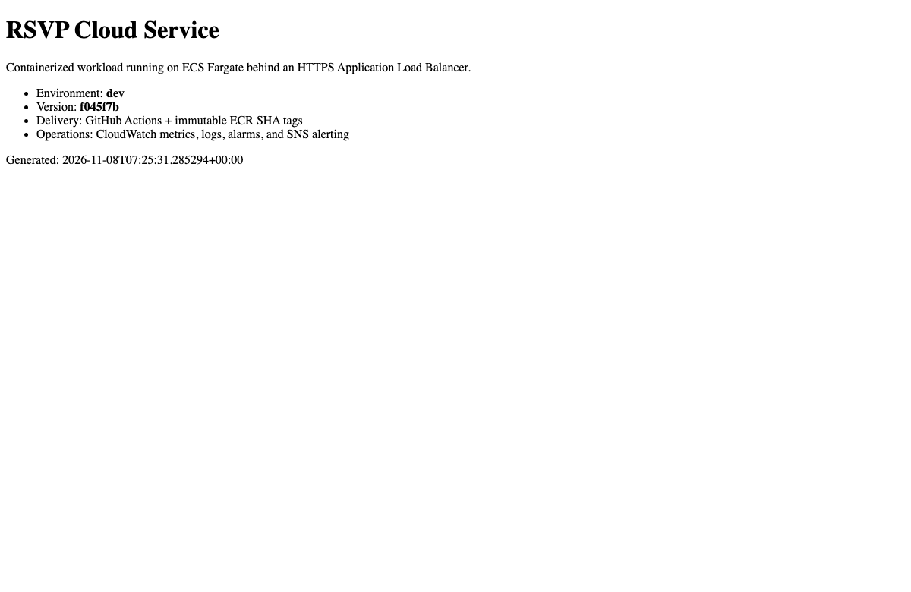

# Part 2 — ECS & CI/CD

**The next question: how do you change a running application without making the environment less reliable?**

The foundation focused on hosting and protecting a workload. This part applies those same networking and reliability principles to container delivery.

```text
GitHub Actions (tests and scanning)
           |
Short-lived AWS credentials via OIDC
           |
Immutable Git-SHA container image in ECR
           |
Private ECS Fargate tasks behind HTTPS + WAF
           |
Health validation and release recovery
```

## Engineering choices

**No stored AWS deployment keys.** GitHub Actions assumes a scoped AWS role through OIDC. Deployment permissions are limited by repository and GitHub Environment; production approval and branch restrictions are part of that boundary.

**Traceable releases.** A container image is associated with a specific Git commit. The release process checks health and the expected version after deployment, so a healthy endpoint serving the wrong version isn't mistaken for success.

**Clear ownership.** Terraform defines the infrastructure and task-definition baseline. GitHub Actions manages application releases. The ECS service is configured so an infrastructure-only Terraform change does not silently roll back the current release. When a baseline changes, the release process needs to promote that new configuration.

**Two different failure paths.** The ECS deployment circuit breaker can recover from unhealthy task deployments. The GitHub workflow also has a rollback path for failed release checks. These are separate mechanisms; one successful test does not prove both.

**Operational security.** Tasks use private networking and a read-only root filesystem. The image build and release workflow include testing and vulnerability scanning.

## What I verified in AWS



The November 8, 2026 exercise confirmed:

- An OIDC-authenticated GitHub release with an immutable ECR image.
- Two healthy ECS tasks running in different Availability Zones without public IP addresses.
- HTTPS, WAF behavior, application logs, and the serving Git revision.
- An intentionally broken ECS task revision recovering to the previous healthy revision in **13 minutes 47 seconds**.

The first container attempt failed because its worker needed a writable temporary location. I corrected that without removing the read-only root-filesystem constraint. After the exercise, rebuilding the image on a newer Debian base reduced ECR HIGH findings from **nine to two**, without claiming those last two were fixed.

The native ECS rollback was proven. Load-driven autoscaling, stage/prod promotion, and the separate GitHub smoke-test rollback were not part of that live exercise.

[Full dated release and rollback results](evidence/2026-11-08.md) · [Scan comparison](evidence/image-rescan.json) · [Controlled release run](https://github.com/JNHolman/RSVP-Cloud-Platform/actions/runs/42458363871)

This part demonstrates that delivery is an engineering system of its own—not just a command that replaces a container.

[Back to the full platform](../README.md) · [Part 3: Governance](../project-3-cloud-governance/README.md)
