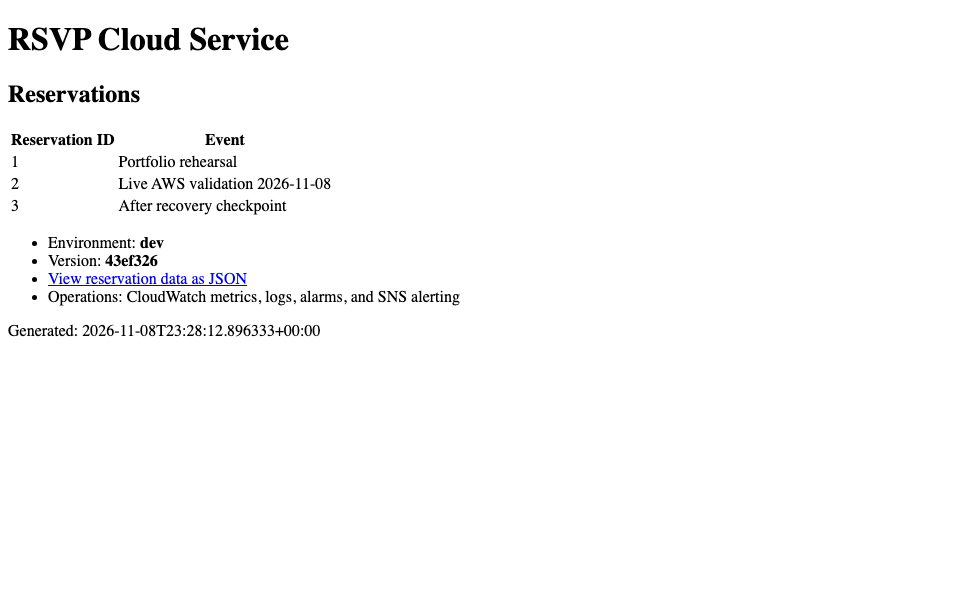

# Project 2 — ECS & CI/CD

Cloud Foundation gave me an application I could reach, troubleshoot and restore. The next question was what happens when I change it.

I moved the same test reservation service into ECS Fargate and connected it back to the private database from Project 1. Then I built a GitHub Actions release workflow that could identify the exact image being deployed, check the version clients actually received and restore the previous version if the release was wrong.

I tested two different failures. In one, ECS saw healthy containers but the application served the wrong version. In the other, the new containers couldn't start. The distinction matters: a platform health check and a correct software release are not the same thing. The evidence below shows how each recovery path behaved.

[Back to the platform story](../README.md) · [The governance layer that follows](../project-3-cloud-governance/README.md)

## How code becomes a verified release

ECS Fargate runs the containers without requiring me to maintain the servers underneath them. I chose it over Kubernetes because I wanted to concentrate on deployment reliability, networking, scaling and rollback rather than cluster administration.

The containers run in private subnets across Availability Zones, behind a public HTTPS load balancer and AWS WAF. The images live in Amazon ECR. GitHub Actions tests the application, scans the image and deploys an immutable image tagged with the source Git revision.

The workflow uses **GitHub OIDC to request temporary AWS credentials**, rather than keeping a long-lived AWS access key in GitHub. AWS checks the workflow's identity before granting those short-lived permissions. Each running task can be matched to its image digest and source revision. I verified that relationship in the live exercise instead of assuming the tag and running task were the same artifact.

~~~mermaid
flowchart TB
    code["Git revision"] --> build["GitHub Actions · tests + image scanning"]
    build --> ecr["ECR · immutable image"]
    build --> oidc["OIDC · temporary AWS role"]
    ecr --> deploy["Controlled ECS deployment"]
    oidc --> deploy
    deploy --> tasks["Private Fargate tasks · two Availability Zones"]
    guest["HTTPS request"] --> edge["Load balancer + WAF"]
    edge --> tasks
    tasks -->|"VPC peering, return routes, scoped IAM access"| db[("Private RDS in Foundation VPC")]
    edge --> probe["Workflow verifies serving version"]
    probe --> decision{"Correct release?"}
    decision -->|"Yes"| accept["Keep the release"]
    decision -->|"No"| rollback["Restore and verify previous revision"]
~~~

Terraform owns the infrastructure baseline: networks, security rules, ECS configuration and the initial task definition. GitHub Actions owns **which application revision is released**. If Terraform changes the task-definition baseline, the controlled release has to promote it intentionally. That keeps an infrastructure update from silently replacing the application with an older image.

### What the automation actually checks

| Stage | What happens | What failure it catches |
|---|---|---|
| **Build and inspect** | Application tests run, the container builds, the image is scanned and it is tagged with the Git revision | Bad application behavior, image-build problems and qualifying fixable vulnerabilities before release |
| **Authenticate** | GitHub exchanges its OIDC identity for temporary credentials on a scoped AWS deployment role | A workflow doesn't need to store an AWS access key or receive unrestricted account access |
| **Deploy** | The workflow selects the image for a new ECS task definition and waits for service stability | Containers that cannot start or remain healthy |
| **Verify from outside** | HTTPS responses are checked for health and the exact expected version | A running container serving the wrong revision |
| **Recover** | On rejection, the workflow restores the previous task definition and verifies the old version again | A rollback that reports success before the previous service is actually answering |

The live AWS release exercised the version check. **The later, stricter workflow also validates reservation data**, including whether a revision can read its expected database, but those candidate and rollback cases were tested with simulated responses after the AWS runtime had been removed. Keeping that distinction is part of making the project credible.

I accepted less control over the container hosts by choosing Fargate instead of Kubernetes. For this project, that was worth it: I could concentrate on the application's image, permissions, network rules, health checks and release decisions.

[Deployment workflow](../.github/workflows/ecs-project2-deploy.yml) · [Application tests](app/tests/test_app.py) · [Release health verifier](verify-release-health.py) · [ECS configuration](terraform/ecs_service.tf)

## Live integrated release on November 8

The most useful test was a release that looked healthy at first.

I deployed a deliberately incorrect application version. ECS had healthy tasks and the HTTPS endpoint responded, but GitHub Actions compared the returned version with the expected Git revision and **rejected the release**. The workflow restored the previous task definition and checked the version served over HTTPS again.

| Live event | Recorded result |
|---|---|
| Wrong-version candidate detected | **23:34:10 UTC** — smoke test rejected the release despite a responding endpoint |
| Previous version confirmed | **23:37:34 UTC** — the workflow verified revision 6 serving Git version `43ef326` |
| Recovery interval | **3m 23s**, measured from rejection to successful verification |

This is different from a container crash: the platform needed an external check to notice that the *wrong* healthy application was serving. [Rejected release run](https://github.com/JNHolman/RSVP-Cloud-Platform/actions/runs/42535446228) · [Successful controlled release](https://github.com/JNHolman/RSVP-Cloud-Platform/actions/runs/42535097319)

### Two ways to reject a release

I tested two failure paths because they answer different questions.

**ECS circuit breaker:** In a separate drill, I registered a revision with an intentionally failing container command. The replacement tasks couldn't stabilize. ECS detected the unhealthy deployment and restored the previous working revision in **13m 47s**. The circuit breaker makes the decision from task and deployment health.

**GitHub release verification:** In the wrong-version drill, the tasks *were* healthy. The release workflow inspected the actual HTTPS response, caught the version mismatch and verified the previous revision in **3m 23s**. This check catches a problem ECS task health cannot.

Both are live AWS observations, but the timing starts from different failure signals. They should not be compared as if they measure the same operation. [Recorded circuit-breaker timeline](evidence/2026-11-08.md) · [Live release and rollback evidence](evidence/live-release-recovery.json)

The initial container launch also exposed a practical failure. Gunicorn couldn't write its worker heartbeat file under the read-only filesystem. Moving the heartbeat location to /dev/shm let the same image start successfully. That failure was worth recording because container security settings need to be tested against the software that actually runs. A hardened image that never starts is not a reliable release.

## Crossing the network boundary

I didn't give the container service a separate toy database or open the original one to the internet. ECS runs in its **own VPC**, connected to the Foundation VPC through private peering and return routes. Security groups constrain MySQL access, and the task uses a scoped database-reader role.

In the integrated exercise, both the original EC2 application and the ECS application returned the same three reservation rows through HTTPS. That confirmed that two applications in different private networks could use the same database through their intended network and permission paths.

Peering the VPCs wasn't enough by itself. ECS needed a route to the foundation database, and the foundation network needed a route back. The database security group had to accept connections from the ECS task security group, while the task's AWS role needed database-reader permission. A missing route and a missing permission can cause similar errors, but they're different problems to investigate. I designed the connection so both boundaries were explicit.

The newer release checks go beyond `/health` and the version number. They ask the reservation API for data from the backend that release is supposed to use. For RDS, the response must include a test record added by the operator; for local SQLite, it must contain the expected fixture data. A rollback checks the *previous version's* database expectations, not those of the failed release.

**Evidence boundary:** Those later database-aware candidate and rollback checks were verified with simulated workflow responses **after the AWS runtime was retired**. The November 8 AWS exercise proved the earlier live version-check and rollback path plus the two private database read paths. It did not run the newer database-aware gate against live ECS.

[Release workflow](../.github/workflows/ecs-project2-deploy.yml) · [Reservation verifier](verify-reservations.py) · [Candidate and rollback tests](tests/test_project2_release_health.py) · [VPC peering and database access](terraform/foundation-db.tf)

## Capacity under load

I sent **1,625 requests** during a controlled test with a temporarily low CPU target. The chart separates the number of tasks AWS *wanted* to run from the number actually running. Desired count increased first; then ECS brought up another task, taking the service from **two running tasks to three**.

That proves scale-out occurred during this exercise. Observation ended before a scale-in completed, so I don't claim a full up-and-down autoscaling cycle. [Task-count observations](evidence/live-scaling.json)

## What I learned about release safety

**A green health check isn't enough.** ECS was right to regard the deliberately wrong-version tasks as healthy: they were running and responding. GitHub Actions needed a different check—one tied to the expected revision. That's why the release pipeline verifies both service stability and what the public HTTPS endpoint actually returns. The newer reservation-data checks add another independent signal, but their live validation remains outstanding.

**Traceable releases require image management.** Tagging an image with the source revision makes it possible to tell exactly what is running and what version to restore. The trade-off is managing old images and their lifecycle instead of casually reusing the same tag.

**Terraform and GitHub Actions need separate jobs.** Terraform sets up the ECS service; GitHub Actions releases the application image. I configured Terraform not to overwrite a running version during an infrastructure-only change. If the infrastructure changes the task-definition baseline, the release workflow must deliberately bring that change forward. Otherwise, one automation system could quietly undo the other's work.

**Short-lived credentials don't replace deployment approvals.** AWS checks which GitHub repository and environment is requesting access, then limits what the workflow can deploy and which roles it can use. On November 10 I restricted the lab’s GitHub `prod` environment to the `main` branch and required a PR to change that branch. Bootstrap and deployment check the latest main-push CI result for the selected commit before requesting AWS credentials. A second person’s approval is optional. These controls postdate the live ECS exercise. [OIDC trust policy](bootstrap-delivery/main.tf) · [Observed GitHub environment settings](https://api.github.com/repos/JNHolman/RSVP-Cloud-Platform/environments/prod)

**A passing scan doesn't mean there are no security findings.** ECR found nine HIGH vulnerabilities in the original Bookworm image. A rebuild on Trixie reduced that to two glibc findings, though I did not deploy the rebuilt image to the retired ECS environment. Trivy blocks releases for qualifying HIGH/CRITICAL vulnerabilities that have fixes. Checkov reports infrastructure findings without blocking the workflow. That means a green job can still require security review. [Image scan comparison](evidence/2026-11-08.md#post-demo-image-remediation) · [Infrastructure review](../shared/checkov-review.md)

Before tearing down the delivery bootstrap in a shared account, verify which Terraform state owns the GitHub OIDC provider and which IAM roles trust it. Retain it while another deployment depends on it.

**Scale-out proves capacity was added, not that scaling is perfect.** During the 1,625-request test, a third task became running. I did not observe a completed scale-in or enough sustained traffic to claim a production capacity benchmark. The ECS task range was configured for two to six tasks; I temporarily lowered the CPU target for the demonstration.

The release record ties the serving Git revision to the image digest. The rollback exercise checked which version actually answered the health request after ECS restored the previous task definition.

The outcome was a release process I could trace back to its source code, a private connection to the same RDS database used in Project 1, and two tested recovery paths. I took the questions about deployment permissions, security ownership and evidence into [Project 3 — Cloud Governance](../project-3-cloud-governance/README.md).

Additional technical evidence

[Build and scan run](https://github.com/JNHolman/RSVP-Cloud-Platform/actions/runs/42534475017) · [Recorded private tasks and image digests](evidence/2026-11-08.md) · [Load observations](evidence/live-scaling.json) · [Image rescan](evidence/image-rescan.json) · [Controlled release verifier](verify-release-health.py)

