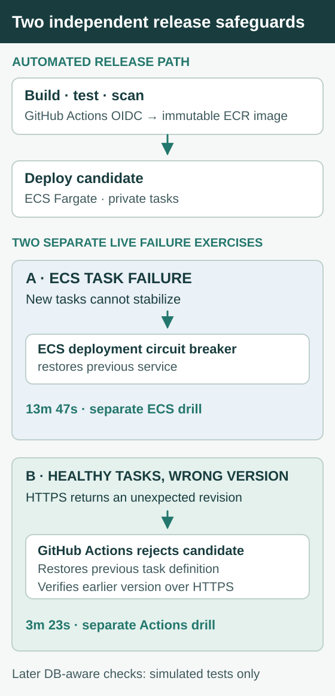

# Project 2 — ECS & CI/CD

Two ECS tasks can report healthy while serving the wrong application revision. That was the failure in the live version-mismatch drill: GitHub Actions rejected the candidate, restored the previous task definition, and verified the earlier version over HTTPS in **3m 23s**.

**ECS & CI/CD separates a running deployment from a correct release.** A second, independent AWS drill tested tasks that could not stabilize; ECS recovered the previous service through its circuit breaker. These are different failure modes with different recovery timelines.

The workload was the same read-only reservation application from [Cloud Foundation](../project-1-cloud-foundation/README.md), moved to private Fargate tasks in another VPC. Both application paths read the same test records in Foundation's private RDS database, so a healthy container alone was not enough to establish success.

## From a commit to a running release

GitHub Actions runs application tests, scans the container image, and publishes to ECR. It uses short-lived AWS credentials from OIDC rather than a stored deploy key. Git-revision tags and image digests make it possible to identify the exact build running on private Fargate tasks.

**Terraform owns the infrastructure baseline; GitHub Actions owns which application image is promoted.** Separating those responsibilities keeps release rollback independent of infrastructure changes. The workflow still has to verify the version clients receive, not just whether ECS tasks reached a healthy state.

[Build run](https://github.com/JNHolman/RSVP-Cloud-Platform/actions/runs/42534475017) · [Successful release](https://github.com/JNHolman/RSVP-Cloud-Platform/actions/runs/42535097319)

## Why two release checks were necessary

ECS and the deployment workflow observe different things:

- **ECS circuit breaker:** rejects tasks that cannot stabilize and restores the previously working service.
- **GitHub Actions HTTPS verification:** checks the environment and served Git revision. If the candidate is healthy but incorrect, the workflow restores the previous task definition and checks the old version over HTTPS.

The live drills exercised each protection separately. The later database-aware version of the workflow also checks reservation rows, but that addition was tested only with simulated responses after AWS teardown.

## Live integrated release on November 8

I tested both failure modes in AWS, in **separate drills with different start conditions**.

| Failure injected | What happened | Recorded recovery |
| --- | --- | --- |
| Healthy endpoint, incorrect version | GitHub Actions rejected the candidate, rolled back to revision 6, and verified `43ef326` was serving | **3m 23s** from rejection to verification |
| Unhealthy ECS deployment | ECS circuit breaker detected task instability and recovered the previous service | **13m 47s** for the separate ECS exercise |

The failed [version-mismatch workflow](https://github.com/JNHolman/RSVP-Cloud-Platform/actions/runs/42535446228) is **evidence that the candidate was correctly rejected**; the successful recovery is confirmed by the prior revision answering HTTPS. The two timings cannot be compared as equivalent recovery intervals.

[Live release record](evidence/live-release-recovery.json) · [Circuit-breaker timeline](evidence/2026-11-08.md)

## The database still had to work

Moving the service into another VPC didn't justify putting MySQL on the public internet. I added VPC peering and return routes to the Foundation database and limited access to the ECS task security group and reader role. Reachability and authorization remained separate requirements.

In AWS, **both EC2 and ECS HTTPS endpoints returned the same three private RDS rows**. Neither private Fargate task had a public IP, and recorded task image digests matched the immutable ECR image. This proved the release could serve real test data, not just its health endpoint.

[Task digests and database readback](evidence/live-release-recovery.json) · [Peering and access rules](terraform/foundation-db.tf)

## Stronger release verification—tested after teardown

The live rollback drill checked version and environment. After retiring the AWS runtime, I extended the smoke test to check the reservation API **for both the candidate and the restored revision**.

SQLite-backed tests expect the rehearsal seed. An integrated RDS release must also return an operator-owned, RDS-only marker (`RDS_SMOKE_EVENT`) in the first ten rows. The task definition determines the backend mode. A failed read rejects the release, and rollback must also serve the expected row before reporting recovery. The API exposes no database address or credentials.

**This addition passed simulated workflow tests; it was not exercised against live ECS/RDS.** The **3m 23s** result applies to the earlier live version-mismatch check, not this later improvement.

[Deployment workflow](../.github/workflows/ecs-project2-deploy.yml) · [Reservation verifier](verify-reservations.py) · [Tests](tests/test_project2_release_health.py)

## Scale and security

I sent **1,625 requests** during a temporary 10% CPU-target exercise. ECS desired capacity rose before the third task reached running state, demonstrating scale-out from **two to three running tasks**. The test ended before scale-in was confirmed.

Rebuilding the same application from the Bookworm to the Trixie base image reduced measured ECR **HIGH** findings from **nine to two**. The remaining glibc findings were CVE-2026-5435 and CVE-2026-19499; the scan doesn't establish exploitability in this application. Trivy rejects qualifying HIGH/CRITICAL findings with known fixes. Checkov remains advisory—green CI does not mean no IaC findings.

[Scaling samples](evidence/live-scaling.json) · [Image findings](evidence/image-rescan.json) · [Scan discussion](evidence/2026-11-08.md#post-demo-image-remediation)

## Ownership and remaining limits

**Task-definition ownership.** Terraform tags the infrastructure baseline `ConfigurationSource=TerraformBaseline`. The workflow clones that definition and changes the release image. That means **after any Terraform change that modifies the ECS task definition**, operators run **Controlled Deploy** to promote the new baseline. This explicit handoff prevents a Terraform update from silently becoming an application release.

OIDC role trust checks repository and environment identity; that is not the same as requiring release approval. **GitHub Environment protection rules for `prod`** must separately **restrict deployment branches/tags** and configure reviewers. At the November 9 inspection, the **production authorization boundary** had no environment-level branch/tag rule or reviewer gate (`deployment_branch_policy: null`, `protection_rules: []`). The AWS drills used dev, not an approved prod gate.

[Role trust policy](bootstrap-delivery/main.tf) · [Environment API](https://api.github.com/repos/JNHolman/RSVP-Cloud-Platform/environments/prod) · [Deployment workflow](../.github/workflows/ecs-project2-deploy.yml)

## Why Project 3 followed

A controlled release still depends on who can assume deployment roles, change security settings, and alter the evidence of what happened. [Project 3 — Cloud Governance](../project-3-cloud-governance/README.md) takes that ownership question beyond the application, with an offline-tested multi-account design and a narrow live test of a deterministic AI security guardrail.

Technical records and evidence

[Recorded task counts](evidence/live-scaling.json) · [Original live timeline](evidence/2026-11-08.md) · [Release test suite](tests/test_project2_release_health.py) · [Infrastructure findings](../shared/checkov-review.md)

