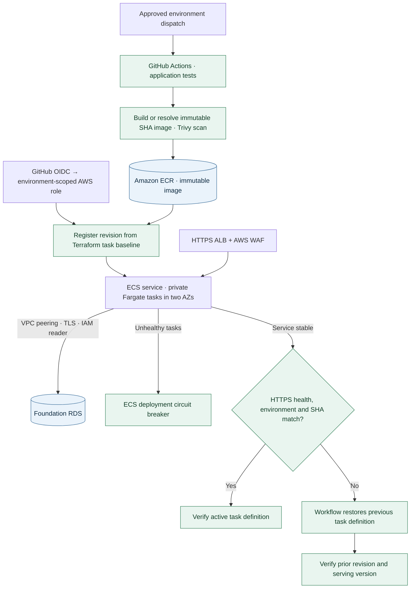

# Project 2 — ECS & CI/CD

A release is identified by its Git revision from build through recovery. A deployment must pass an HTTPS version check before the workflow reports success.

**Recovery benchmarks:** ECS recovered an unhealthy revision in **13m 47s**. In the separate version-mismatch exercise, the GitHub workflow verified the previous release in **3m 23s** from smoke-check failure. [Native rollback timeline](evidence/2026-11-08.md) · [Workflow run](https://github.com/JNHolman/RSVP-Cloud-Platform/actions/runs/42535446228)

## Live integrated release on November 8

The dev workflow released Git revision `43ef326` to private Fargate tasks. The service read marker 2 from the foundation's RDS instance over VPC peering. Its HTTPS response matched the EC2 endpoint. [Live ECS page](evidence/live-rds-reader.png) · [Runtime observations](evidence/live-release-recovery.json) · [Successful deployment](https://github.com/JNHolman/RSVP-Cloud-Platform/actions/runs/42535097319)

A separate dev-only workflow run deliberately served a mismatched version. The smoke check detected it at 23:34:10 UTC and the workflow verified the previous serving revision at 23:37:34 UTC, approximately 3m 23s later. The workflow ended with a failure status as designed. [Controlled rollback workflow](https://github.com/JNHolman/RSVP-Cloud-Platform/actions/runs/42535446228)

## Original exercise checklist

[Exercise report and homepage screenshot](evidence/2026-11-08.md) · [Recorded observations](evidence/observations.json)

| Area | Evidence available | Evidence still needed |
|---|---|---|
| Delivery and networking | GitHub OIDC release, ECR digest, private targets and serving Git revision | Capture a release summary alongside the serving revision |
| Security and monitoring | WAF 403, CloudWatch streams and ECR scan comparison | Rebuild and rescan after a supported fix for the two remaining high findings |
| Recovery and scaling | ECS restored the previous healthy revision in 13m 47s | Exercise GitHub smoke-test rollback and measure scale-out and scale-in |

## Read the foundation database

The integrated dev release serves the same Flask source as EC2. Supply the foundation's `foundation_db` output to the ECS runtime as an input of the same name. It contains the RDS hostname, database resource ID and private network identifiers. Generate it from the verified dev backend after the foundation is available. Pass only this named output, keeping raw state and local Terraform values out of Git.

ECS owns the peering connection, return routes, database-reader policy and security-group rules it adds. The foundation retains ownership of RDS, its security group and private route tables. Use non-overlapping VPCs in the same account and region. Remove the ECS runtime and its connection before retiring the foundation.

From a private operator session, initialize the configured database with the application's `demo.sql`, create `rsvp_reader` with the RDS IAM authentication plugin, require TLS, and grant SELECT only on `demo_reservations`. For live evidence, insert a second, uniquely named exercise record through the operator session. Capture that exact record via both HTTPS endpoints, with the running ECS revision and corresponding database query. The image's independent SQLite fixture cannot supply that record.

## Operations

Before using the production OIDC role, configure **GitHub Environment protection rules for `prod`**: **restrict deployment branches/tags** to approved release sources and require reviewer approval where supported. Environment protection is part of the **production authorization boundary**, because AWS trust scopes the OIDC subject to the repository and environment.

**Locations:** `project-2-ecs-cicd/bootstrap-delivery/` and `project-2-ecs-cicd/terraform/`

1. **Bootstrap delivery.** Use the bootstrap Terraform root in the intended AWS account. It manages the ECR repositories, the GitHub OIDC provider and environment-specific deployment roles. Confirm the account does not already have an independently owned OIDC provider before making changes.
2. **Configure GitHub.** Set `AWS_DEPLOY_ROLE_ARN` in the matching GitHub Environment. Also set `AWS_REGION` and `PROJECT_NAME` if not using the defaults (`us-east-1`, `rsvp-project2`). For stage/prod, restrict approved branches/tags and require approval where supported.
3. **Build the first image.** Run **ECS Project 2 - Bootstrap First Image** for the target environment. Copy the exact immutable Git-SHA image URI into the local runtime `terraform.tfvars` as `container_image`. Do not use `:latest`.
4. **Deploy the runtime.** Initialize `project-2-ecs-cicd/terraform/` with its matching dev backend, review its plan, and apply only after approval.
5. **Finish GitHub configuration.** Set `SERVICE_URL` to the service's verified HTTPS URL. Run **ECS Project 2 - Controlled Deploy**, then confirm that `/health` returns the expected release and environment.

**What to verify:** Two healthy private tasks in separate AZs, HTTPS, WAF, logs, the ECR image digest and GitHub's deployment result. The ECS circuit-breaker rollback and GitHub workflow rollback are separate behaviors. Verify each through its own controlled failure path. Use bounded load for autoscaling and record both scale-out and scale-in events.

**Task-definition ownership:** Terraform registers the infrastructure and security baseline, tagged `ConfigurationSource=TerraformBaseline`. The ECS service intentionally ignores `task_definition` drift so a later Terraform apply cannot roll back a GitHub-deployed application release. Therefore, after any Terraform change that modifies the ECS task definition, run **Controlled Deploy** before treating that configuration change as active. The workflow clones the latest Terraform baseline, replaces only the release image/version, and promotes that revision to the service.

[Platform overview](../README.md) · [Shared state, DNS, costs and teardown](../shared/OPERATIONS.md)

During the [bounded load exercise](evidence/live-scaling.json), 1,625 requests drove the service from two running tasks to three with a temporary 10% CPU target. Observation ended before scale-in was confirmed.
