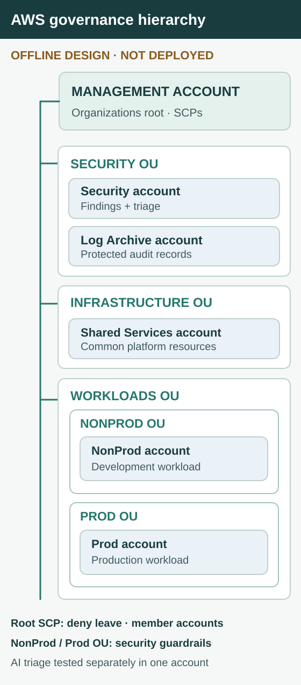
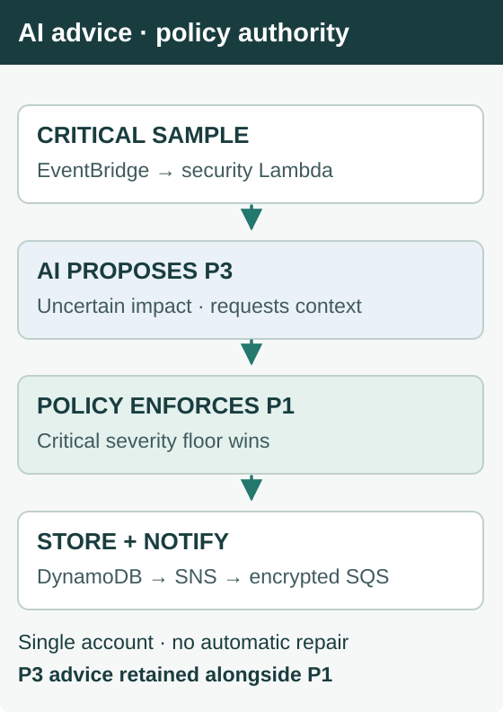

# Project 3 — Cloud Governance

In a live AWS rehearsal, an AI model recommended **P3** for a finding labeled **CRITICAL**. The finding was deliberately sparse: no affected resource, originating security product, or confirmed impact. The model's uncertainty was understandable, but it was not a reason to lower the severity required by policy.

**Cloud Governance keeps security policy authoritative while preserving the evidence behind an AI recommendation.** The Lambda applied a code-defined **P1** severity floor, stored both priorities, and sent a notification to an encrypted SQS test subscriber. It did not remediate anything.

That exercise tested one control in a single AWS account. I also designed a **six-account AWS Organizations structure** to separate workload operations, security administration, and audit custody. Its Terraform and policy tests passed offline; the organization and cross-account controls were **not deployed**.

## How the account boundaries work

The design has one **management account** and five **member accounts**, grouped by responsibility:

- **Security OU:** Security handles findings and investigation; **Log Archive** holds encrypted organization audit records outside workload control.
- **Infrastructure OU:** **Shared Services** hosts common platform components.
- **Workloads OU:** contains distinct **NonProd OU** and **Prod OU** branches. Each nested OU holds its matching member account and receives its own workload security-control policy.

The management account defines AWS Organizations, organizational units, and SCPs. IAM Identity Center supplies administrator, platform operator, and read-only permission sets with account-specific assignments. Platform operators can work on applications without automatically receiving security administration privileges.

**SCPs restrict what member-account principals may do; they do not grant permission and do not constrain the management account.** The design attaches a root-level guardrail against leaving the organization and attaches security-control guardrails directly to the nested NonProd and Prod OUs.

[Account configuration](organization/accounts.tf) · [OU layout](organization/organization.tf) · [SCP attachments](organization/scps.tf) · [Identity Center](identity-center/main.tf)

## Why security and audit live elsewhere

A workload team should not control the only audit record of its own actions. The Terraform design sends multi-region, organization-wide CloudTrail management events to a dedicated Log Archive account, protected with KMS encryption, public-access blocks, and retention controls. A separate Security account is responsible for centralized security visibility and incident investigation.

The dashboard design uses scoped read-only roles to query incident and cost information. Its purpose is to explain operational and spending changes, not to mutate cloud resources.

**These are designed boundaries, not an operating six-account environment.** The trail, dashboard, and cross-account access were not deployed end to end.

[CloudTrail design](audit-trail/main.tf) · [Log archive](log-archive/main.tf) · [Dashboard API](workload/dashboard_api.py) · [FinOps code](finops-ai/cost_analyzer.py)

## Live AWS exercise

The critical sample entered on a private EventBridge bus. Because it contained no originating detector or resource identifiers, the model recommended collecting more context and assigned P3. The handler retained that assessment but enforced P1 before storing the decision in DynamoDB and publishing the SNS message received by the encrypted SQS subscriber.

The same code also redacts identifying fields, validates the structured model response, and computes a low-confidence severity-based fallback if analysis fails. **This live run used the successful-model path, not the fallback.** The event was a labeled rehearsal, not a real Security Hub finding.

The result is a preserved disagreement: an operator can see why the model proposed P3 without allowing that suggestion to weaken an enforced rule. This protects the decision boundary without hiding uncertainty or automating remediation.

[Saved decision and queue receipt](evidence/aws-incident-exercise.json) · [Handler and severity rule](security-admin/ai_incident_analyzer.py)

## What was tested—and what wasn't

| Evidence | Result | Limit |
| --- | --- | --- |
| **Live AWS, one account** | EventBridge → AI assessment → P1 policy floor → DynamoDB → SNS → SQS receipt | Labeled rehearsal input, not an actual Security Hub detector finding |
| **Offline policy checks** | Terraform format/validation/tests passed; IAM Access Analyzer returned zero findings for two generated default SCP documents | Does not prove SCP inheritance or denial in member accounts |
| **Enterprise architecture** | Six-account Terraform design and dashboard components | Organization, cross-account roles, dashboard, and audit delivery not deployed end to end |

I avoided enabling shared Config, GuardDuty, CloudTrail, or Security Hub CSPM services purely for this portfolio, because they could expand collection and costs in the account shared with the real RSVP Society business. Cost Explorer returned **zero active cost-allocation tags**, so I did not attribute unrelated Society spending to the lab.

[Offline SCP tests](modules/scp-policies/tests/guardrails.tftest.hcl) · [Policy validation result](evidence/aws-policy-validation.json) · [Governance tests](tests/test_governance_infrastructure.py)

## Design assumptions and limitations

The six-account architecture assumes separate **state-bootstrap outputs** and account-specific encryption keys. The backend value `REPLACE_WITH_TERRAFORM_STATE_KMS_KEY_ARN` remains a placeholder, not evidence of a configured backend. Referencing an existing account **does not move those accounts** between OUs. **An account outside the target OU will not inherit that OU's SCPs.**

StackSets delegated administration depends on CloudFormation trusted access through `ActivateOrganizationsAccess`. Organization-wide AWS Config aggregation covers accounts only **where Config recording is enabled**. These dependencies were identified in the design; their cross-account operation was not demonstrated live.

[Deployment prerequisites](organization/prerequisites.tf) · [Organization config](organization/organization.tf) · [Delegated administration](organization/delegated-admin.tf)

## Where the platform story ends

Cloud Foundation separated observed failures from suspected causes and verified database recovery. ECS & CI/CD separated task health from release correctness. Cloud Governance applies the same discipline to authority: operators can act on workloads, investigators can examine evidence, and deterministic policy remains in charge of critical security decisions.

The six-account separation is an **offline-validated design**. The P3-to-P1 rule is a **single-account live exercise**. Neither is presented as a deployed enterprise security program.

Supporting CI screenshot and evidence

The screenshot shows the `project3-offline` GitHub Actions job passing Terraform formatting, validation, and policy tests. It is **not evidence of deployed member-account controls**.

[Security exercise record](evidence/aws-incident-exercise.json) · [Offline policy results](evidence/aws-policy-validation.json)

