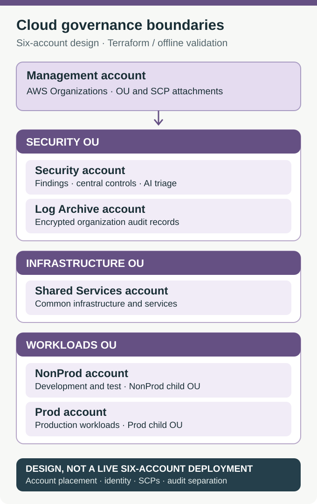

# Project 3 — Cloud Governance and AI Security Operations

A team that deploys an application should be able to fix that application. It should not automatically be able to disable the security controls monitoring it, erase the audit trail of its actions or decide that a critical finding is unimportant.

**I designed an AWS governance platform around that separation of duties, then tested one of its security decisions in a live single-account exercise.** This builds on [Cloud Foundation](../project-1-cloud-foundation/README.md) and [ECS Delivery](../project-2-ecs-cicd/README.md): those projects operate the workload; this one defines who can administer, investigate and audit it.

There are **two different validation scopes** here. The six-account architecture is Terraform design plus offline tests, **not a deployed six-account organization**. The AI-assisted security decision was exercised in AWS with a labeled sample event and a real notification path.

## The six-account design

AWS Organizations is the management boundary. Five member accounts separate duties that would be unsafe to combine in a larger organization:

- **Management:** Organization-wide structure, account placement, service control policy (SCP) attachments and trusted-service setup.
- **Security:** Central administration for Security Hub, GuardDuty, AWS Config aggregation and AI-assisted finding triage.
- **Log Archive:** An independent destination for encrypted, versioned organization CloudTrail records.
- **Shared Services:** Common infrastructure and delegated operational services.
- **NonProd:** Application development and test workloads.
- **Prod:** Production application workloads, separated from experimentation.

The design places Security and Log Archive in a Security OU, Shared Services in Infrastructure, and NonProd and Prod under separate workload OUs. This is more than account naming: policy inheritance, assigned identities and data ownership are different in each part of the organization.

[Account definitions](organization/accounts.tf) · [Organization and OU structure](organization/organization.tf) · [Delegated administration](organization/delegated-admin.tf)

## Key engineering decisions

### Keep security controls outside workload ownership

A deployer should have operational access to a service without also controlling its organizational guardrails. The Terraform defines two example SCPs:

- **Deny leaving the organization** attaches at the organization root and is intended to cover member accounts.
- **Protect security controls** attaches to the Prod and NonProd OUs to limit attempts by ordinary workload principals to disable central security functions.

SCPs restrict the *maximum* permissions available; they do not grant permissions. They also do **not** restrict the Organizations management account, and OU policies do not cover accounts outside the OU. In this repository, Terraform validates and tests the policy documents offline. Live member-account enforcement was **not** demonstrated.

[Policies and attachments](organization/scps.tf) · [Policy definitions](modules/scp-policies/main.tf) · [Offline guardrail tests](modules/scp-policies/tests/guardrails.tftest.hcl)

### Separate identities and preserve audit history

IAM Identity Center permission sets represent different jobs: **CloudAdministrator**, **PlatformOperator** and **EngineeringReadOnly**. The Terraform assigns these to appropriate accounts rather than assuming everyone needs administrator access. Identity Center must be enabled first; the repository does not claim that a full live assignment rollout was completed.

The audit design sends organization CloudTrail management events to a dedicated Log Archive account. The destination uses an encrypted S3 bucket, versioning, restricted access and log-file validation. A workload operator should not be the sole owner of the records an investigator needs to review that workload.

[Identity Center permissions](identity-center/main.tf) · [Organization trail](audit-trail/main.tf) · [Log archive](log-archive/main.tf)

### AI can recommend priority, not lower a critical security alert

A model can be useful when security findings are incomplete: it can summarize the available context and suggest what to investigate next. But an AI-generated priority must not silently override a security rule.

The security handler therefore keeps **two values**: the model's recommended priority and the final priority after deterministic severity enforcement. If the model call fails, a severity-based fallback still produces a record. DynamoDB preserves the assessment, while SNS can deliver an alert reference.

This design makes the policy decision inspectable instead of hiding disagreement between the model and the control. [Security analyzer](security-admin/ai_incident_analyzer.py) · [Security event wiring](security-admin/ai-operations.tf)

### Provide operational visibility without broad write access

The proposed dashboard API uses authenticated access and dedicated read roles to obtain incident and cost summaries. Its purpose is to give operators a cross-account view without granting them write access to the underlying security or financial records.

The FinOps code can analyze cost changes, but meaningful account-specific reporting requires usable billing attribution. In the shared lab account, there were **zero active cost-allocation tags**, so I did not claim a reliable portfolio-only cost report.

[Dashboard API](workload/dashboard_api.py) · [API and identity controls](workload/api.tf) · [Cost analyzer](finops-ai/cost_analyzer.py)

## The live security exercise

The question was simple: **What happens if AI treats a critical finding as a routine rehearsal?**

I sent a labeled critical sample to a private EventBridge bus in the one AWS account available for this test. It was intentionally missing a concrete affected resource and originating security product. That is why the model questioned its operational impact.

1. **Input:** A sample event carried the severity label `CRITICAL`.
2. **AI assessment:** The model recognized likely exercise data and proposed **P3**, requesting more evidence of an affected resource.
3. **Policy decision:** The handler applied the configured critical severity floor and enforced **P1**.
4. **Evidence and delivery:** DynamoDB stored both the proposed P3 and enforced P1. SNS delivered the alert to an **encrypted SQS test subscriber**.

The model did **not** establish a real attack or confirmed business impact. The valuable result was demonstrating that incomplete AI triage could **not lower the final priority below policy**. Human receipt and remediation were not part of this test.

[Recorded finding, model output, enforced priority and notification receipt](evidence/aws-incident-exercise.json)

## What passed, and what remains unverified

**Validated:**
- The live EventBridge → Lambda → model → severity floor → DynamoDB/SNS path for one labeled sample.
- AWS IAM Access Analyzer policy validation returned **zero findings** for two generated SCP documents. That is document validation, **not proof of enforcement**.
- Offline Terraform formatting, validation and guardrail tests ran successfully. [Policy validation evidence](evidence/aws-policy-validation.json) · [Screenshot of the offline CI job](evidence/offline-ci.png)

**Not validated live:** Creation and enforcement of all six accounts, OU-wide SCP behavior, Identity Center assignments, organization CloudTrail delivery into the Log Archive, a deployed dashboard, cross-account read roles, and production Security Hub/GuardDuty/Config integrations. The lab did not enable shared-account security services solely to generate portfolio screenshots or incur extra cost.

The live exercise began at EventBridge with an intentionally labeled sample, **not an actual Security Hub detection**. The dashboard and FinOps paths have code and offline coverage but no claimed live cross-account integration.

### Deployment prerequisites, not completed work

Using `existing_account_ids` references other accounts; it **does not move those accounts** into the intended organizational units. An account outside the target OU will not inherit that OU's SCPs. Operators must verify account placement before relying on OU-level restrictions.

Each account's backend uses separate **state-bootstrap outputs** for the state bucket, locking and encryption. The example `REPLACE_WITH_TERRAFORM_STATE_KMS_KEY_ARN` must be replaced with the owning account's real encryption key before deployment. CloudFormation StackSets delegated administration additionally requires `ActivateOrganizationsAccess` to establish trusted access before the Terraform configuration can use it.

These are deployment requirements and validation boundaries, not completed live controls.

## Inspect the implementation

[Organization and account structure](organization/) · [Security operations](security-admin/) · [Audit trail](audit-trail/) · [Log Archive](log-archive/) · [Identity Center](identity-center/) · [Workload dashboard](workload/) · [Governance tests](tests/test_governance_boundaries.py)

**What the project demonstrates:** account and policy design that separates duties, security evidence that is not owned only by its subject, and a tested rule that keeps an AI recommendation from weakening critical alert handling.
