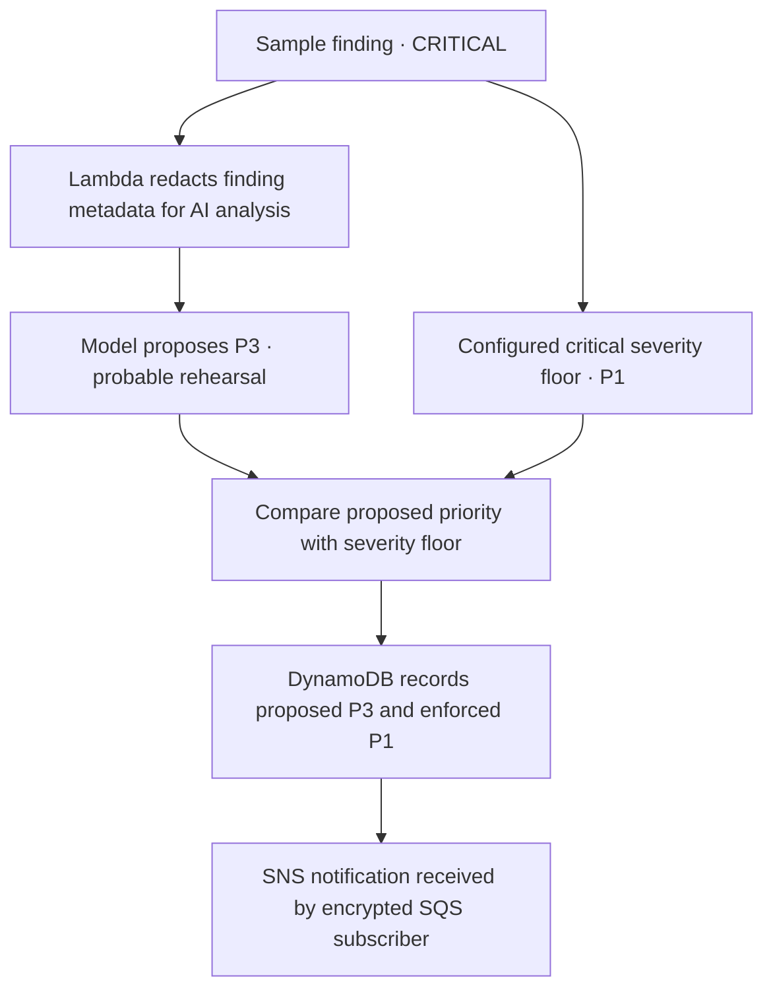

# Project 3 — Cloud Governance

The foundation and delivery exercises gave me a workload I could operate. In a larger organization, the team deploying that workload should be able to fix its application without also controlling the policies that constrain it or the audit history used to investigate it. I designed those responsibilities around separate AWS accounts, then chose a security decision I could exercise safely in the one account available to me.

## Who controls what in the enterprise design

| Responsibility | Design decision | Reason |
|---|---|---|
| Management and identity | AWS Organizations defines policy boundaries. Identity Center assigns administrator, platform operator and read-only permission sets. | A person’s job determines their access. Service control policies set the outer limits for member accounts. |
| Security and audit | The security account handles findings. A separate log archive holds encrypted organization trail records. | An investigator can examine a workload without relying solely on records held by its operator. |
| Application teams | Workload accounts run applications. The dashboard assumes dedicated roles to read incident and cost summaries. | A shared operational view can be assembled without granting write access to the underlying investigations. |

Terraform and offline tests cover this six-account design. For the live exercise I used the existing handler and a private event bus to test one decision end to end: would a critical alert still reach an operator if the model thought it deserved a lower priority?

## Live AWS exercise

A labeled critical sample arrived on a private EventBridge bus. It contained no affected resource or originating product. That gave the model good reason to question the evidence. The alert still carried a critical severity label.

The model recommended checking the exercise origin and identifying the resource before attributing business impact. Its report said:

> No confirmed business impact can be determined from the supplied evidence.

The handler raised P3 to P1 and kept the original recommendation. An investigator can see why the model was cautious and why the alert was sent anyway. If analysis fails, the handler derives a fallback priority from the finding’s severity. The recorded AWS exercise took the model-success path. [Decision logic](security-admin/ai_incident_analyzer.py)

IAM Access Analyzer returned **zero findings** for both Terraform-generated default SCP documents. Member-account enforcement remains unverified. The cost-analysis code reads billing data to explain changes in spend. In this shared account, Cost Explorer returned zero active cost-allocation tags. Charging unrelated Society usage to the lab would misstate its cost, so I skipped the portfolio-only report. [Cost analysis implementation](finops-ai/cost_analyzer.py)

[Analysis and severity enforcement](security-admin/ai_incident_analyzer.py) · [Generated governance policies](modules/scp-policies/main.tf)

### Limits of the single-account lab

Read-only inventory in us-east-1 found no AWS Config recorder status, CloudTrail trail or GuardDuty detector. The account was unsubscribed from Security Hub CSPM. Enabling these shared services would expand collection and cost beyond the portfolio resources. The live exercise therefore starts at EventBridge with a labeled sample. The security dashboard API assumes dedicated Security and FinOps read roles to query both tables. Its behavior has offline coverage; a deployed dashboard and cross-account access remain unverified.

The six-account design uses separate state-bootstrap outputs for each backend. The example value `REPLACE_WITH_TERRAFORM_STATE_KMS_KEY_ARN` marks the owning account’s encryption key. Referencing existing accounts does not move those accounts. An account outside the target OU will not inherit that OU's SCPs. StackSets delegated administration also depends on trusted access through `ActivateOrganizationsAccess`. [Offline policy tests](modules/scp-policies/tests/guardrails.tftest.hcl)

Technical evidence records

[Incident and delivery record](evidence/aws-incident-exercise.json) · [Policy validation results](evidence/aws-policy-validation.json)

