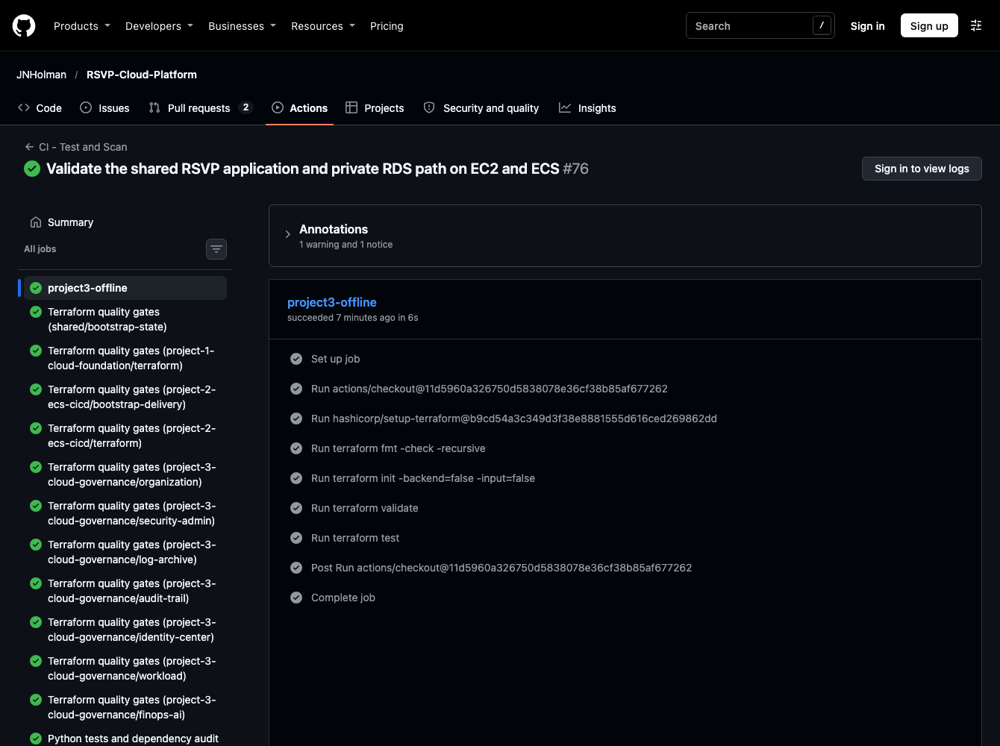

# Project 3 — Cloud Governance

After building the application path and automating releases, I wanted to look at something that matters just as much in a larger environment: who has the authority to change things, and who gets to review what happened afterward?

That question is familiar from enterprise networking. The person restoring a service shouldn't automatically control the security rules or the audit evidence used to investigate it. I designed a six-account AWS model to show how management, security, logging and workloads could be separated when an organization actually needs those boundaries.

**I deliberately didn't create six new accounts just for this portfolio project.** It would have added setup and potential service costs without enough extra proof to justify them. Instead, I validated the account structure and security policies offline and used the AWS account I already had for a focused live test of AI-assisted security triage. The point was to demonstrate the engineering decisions, not to operate a miniature enterprise.

[Back to the platform story](../README.md)

## Who should control what?

The six accounts have different jobs: **Management** sets the rules, **Security** investigates findings, **Log Archive** keeps audit records, **Shared Services** holds common infrastructure responsibilities, **NonProd** is where teams test changes, and **Prod** is where approved applications run. Cost analysis and the read-only dashboard are functions across the design, not extra accounts.

| Responsibility | Engineering choice | Why it matters |
|---|---|---|
| **Management and identity** | AWS Organizations, organizational units, service control policies and IAM Identity Center permission sets | Access follows a person's role, with organization-level limits beyond workload permissions |
| **Security operations** | Dedicated security administration, GuardDuty and Security Hub patterns, AWS Config aggregation where recording is enabled | Investigators can review findings without needing to administer the application |
| **Audit custody** | Separate log archive and encrypted organization CloudTrail design | A workload operator should not be the sole custodian of the evidence about that workload |
| **Application teams** | Workload account and scoped operational roles | Teams can run services without inheriting organization-wide administrator access |
| **Cost and reporting** | Cost Explorer analysis and read-only dashboard roles | Operational and spending context can be shared without granting blanket write permissions |

~~~mermaid
flowchart TB
    mgmt["Management · policies and identity"]
    mgmt --> sec["Security · findings and triage"]
    mgmt --> logs["Log Archive · encrypted audit records"]
    mgmt --> shared["Shared Services · common infrastructure"]
    mgmt --> test["NonProd · application testing"]
    mgmt --> prod["Prod · approved workloads"]
    test -. "Security findings" .-> sec
    prod -. "Security findings" .-> sec
    test -. "Audit records" .-> logs
    prod -. "Audit records" .-> logs
    sec --> dashboard["Read-only operational view"]
    fin["Cost analysis"] --> dashboard
~~~

*The arrows show oversight and controlled access, not permission for every account to administer the others.*

Separating accounts is only the start. Terraform state, encryption keys, deployment roles and administrator permissions also need clear owners. A policy only protects accounts placed in the right organizational unit. Likewise, AWS Config can only collect security configuration data from accounts that have recording enabled. Those dependencies are part of the design.

### How the guardrails are meant to work

The design defines an organization-wide policy intended to prevent member accounts from leaving. Another protects central logging and security services in the production and nonproduction account groups. That second protection only applies to accounts placed in those groups. These service control policies **limit permissions; they don't grant them**. They also don't restrict the organization's management account.

IAM Identity Center then provides role-based access for administrators, platform operators and read-only users. The design delegates GuardDuty and Security Hub administration to the security account, while audit records are designed to flow to a separately controlled encrypted log archive. The point is that an application owner can repair a service without automatically becoming its own security auditor.

Those controls depend on setup in the right order. Existing accounts need deliberate placement, Identity Center and delegated service access must be configured, and the correct accounts must own their Terraform state and encryption keys.

[Organization policies and attachments](organization/scps.tf) · [Delegated administrator configuration](organization/delegated-admin.tf) · [Offline policy tests](modules/scp-policies/tests/guardrails.tftest.hcl)

The dashboard design puts security and cost summaries in one place. It uses a protected API, a second sign-in check (MFA), web-request filtering and read-only roles. An operator could inspect a finding without permission to change it. The API handles sign-in separately from the roles that read data, making it clearer what each part can access.

[Organization design](organization/organization.tf) · [Guardrail policies](modules/scp-policies/main.tf) · [Security administration](security-admin/securityhub.tf) · [Log archive](log-archive/main.tf) · [Identity Center](identity-center/main.tf) · [Dashboard API design](workload/api.tf)

## Live AWS exercise

For the live exercise, I reused the AWS account already available and tested one security decision: **would an alert labeled critical stay critical if AI judged the available evidence to be weak?** That let me test the AI and policy boundary using resources I already had.

I sent a **CRITICAL** sample alert to a private EventBridge bus without naming the affected resource or where the alert came from. This was a controlled test of the triage process, **not** a real GuardDuty or Security Hub finding. The model recognized the event as a likely rehearsal, couldn't confirm business impact and recommended a lower priority.

The model wasn't irrational. There genuinely wasn't enough detail to prove what had been affected. In the saved response it said there was no confirmed business impact. But allowing an advisory model to silently downgrade a critical input would create a different risk. The policy floor wasn't a claim that a critical incident had actually occurred; it was a rule that the **incoming critical classification still required P1 attention** until investigated.

| Stage | What the recorded exercise showed |
|---|---|
| **Incoming signal** | EventBridge received a sample labeled **CRITICAL**, without a named resource or originating product |
| **AI recommendation** | The model proposed **P3**, asking for more information before claiming impact |
| **Enforced decision** | A deterministic severity floor raised the final priority to **P1** |
| **Audit record** | DynamoDB kept both the model's proposal and the priority actually applied |
| **Notification** | SNS delivered the result to an encrypted SQS test subscriber |

[Inspect the model response, policy decision and delivery receipt](evidence/aws-incident-exercise.json)

The handler preserved the model's cautious explanation, including the fact that no business impact had been confirmed. It also preserved *why* policy overrode the recommendation. An engineer reviewing the alert can see both decisions rather than being presented with one unexplained number.

If AI analysis fails or returns an invalid answer, the handler uses the finding's original severity to set priority. The first exercise tested the successful model-response path.

The current handler sends hashed finding and resource references, selected classification fields and severity to the model. Titles, descriptions and arbitrary resource names stay out of the request. Both incident handlers use their existing DynamoDB tables to checkpoint completed investigations. Replays reuse that result, while a change such as a severity increase triggers a new assessment. If SNS accepts a notification but its acknowledgement is lost, a retry can send it again. A failure before the analysis checkpoint can repeat a model call. These retry cases were exercised offline.

In the current implementation, the model explains triage priority from limited metadata. Confirming a cause requires the original finding. Each high-priority notification carries a DynamoDB table and key. An authorized operator can use GetItem there to retrieve the Security Hub finding ID, product ARN and Region. This source record is excluded from the dashboard index and model request.

On November 10 (Eastern time), I invoked the merged Lambda directly with a labeled sample finding. Its scoped role wrote to the KMS-encrypted table. Both the first alert and the reopened alert reached encrypted SQS, and both pointers retrieved the sample’s source identifiers. Replay preserved the original analysis timestamp. Closure and suppression were recorded, with no additional notification observed during the 15-second check.

Two deliberate fallback invocations then triggered the CloudWatch alarm. The subscriber received its ALARM notification about one minute after the second fallback. This exercise began at Lambda. Native Security Hub detection and EventBridge routing from Security Hub remain unverified. [Finding lifecycle and alarm receipt](evidence/live-finding-lifecycle.json)

The current fallback alarm threshold is one failure within 15 minutes, changed from the two-failure setting used in the recorded exercise. Terraform also defines a first-message alarm for the investigation dead-letter queue. These updates were checked offline, not exercised in AWS. Security notifications require a configured SNS topic; the default is intentionally silent.

[Security decision logic](security-admin/ai_incident_analyzer.py) · [Operational event handler configuration](security-admin/ai-operations.tf)

## What was tested, and what remains a design

The evidence separates the **live security-triage exercise** from the **offline checks of the broader multi-account design**:

| Area | Validation boundary |
|---|---|
| **Live in AWS** | Private event delivery, AI assessment, P1 policy floor, stored decisions and encrypted test-subscriber receipt. A separate direct invocation verified source lookup, finding lifecycle and fallback alarm delivery |
| **Offline Terraform/policy checks** | Six-account structure, guardrail policy behavior and code-level boundaries |
| **AWS policy inspection** | IAM Access Analyzer returned **zero findings** for two generated default SCP documents; this does not prove member-account enforcement |
| **Designed but not validated across accounts** | Delegated security administration, organization-wide trails, account-level SCP enforcement and live cross-account dashboard reads |

[Offline policy tests](modules/scp-policies/tests/guardrails.tftest.hcl) · [Policy validation record](evidence/aws-policy-validation.json) · [Governance boundary tests](tests/test_governance_boundaries.py)

Read-only inventory of the shared us-east-1 account did not find an active AWS Config recorder status, CloudTrail trail or GuardDuty detector; Security Hub CSPM was unsubscribed. I did not enable those shared services merely to make the portfolio look more complete. That would have changed the security collection and cost profile of an account supporting an actual business.

The organization-trail design also has a real monitoring limitation: it defines encrypted S3 delivery with log-file validation, but **not CloudWatch Logs delivery or trail-based metric alerts**. The archive is designed to retain evidence; it does not yet provide the rapid management-event detection path a mature security operations program would need. The single-account EventBridge sample does not close that gap. [Infrastructure security review](../shared/checkov-review.md)

For the same reason, I didn't assign the platform a made-up monthly cost. Cost Explorer returned zero active cost-allocation tags, so I couldn't separate RSVP Cloud Platform spending from RSVP Society spending reliably. The FinOps analyzer is implemented, but a portfolio-specific live billing report would not have been trustworthy. [Cost analysis code](finops-ai/cost_analyzer.py)

## Engineering decisions and trade-offs

In a larger organization, separating security and audit records from application teams improves oversight but adds account setup, cost and cross-account coordination. That's a trade-off worth understanding even though I didn't need to deploy the full design to test the AI security decision.

| Decision | Benefit | Trade-off or verification needed |
|---|---|---|
| **Six-account design without six deployed accounts** | Shows how management, security, logging and workloads should be separated at scale | Live cross-account enforcement is outside the portfolio exercise |
| **Separate security and log-archive accounts in the design** | Investigators could use evidence held outside the workload's control | A real rollout needs separate state backends, KMS ownership and cross-account trust |
| **Organization-level policies plus scoped IAM roles** | Application users cannot simply grant themselves exceptions to protected workload guardrails | SCPs restrict permission but don't grant it, and their effect depends on account attachment |
| **Dedicated read roles for the dashboard** | Security and cost data can be inspected without broad write permissions | Cross-account role assumption and the deployed API must be tested in a real organization |
| **Deterministic priority above AI advice** | An incomplete model assessment can't silently lower a critical alert | A P1 label still requires a human to establish impact and decide what to do |
| **No forced deployment of shared security services** | Protects RSVP Society from changes and costs unrelated to its workload | Centralized collection, delegated administration and live member-account enforcement remain unverified |

### What I'd test in a real multi-account rollout

If I were deploying this for an organization rather than validating it as a portfolio design, I'd test the boundaries from both sides: a workload principal **cannot** disable protected security services; a security administrator can view the findings; and an audit reader can retrieve records from the independent archive. I'd also check that the Cognito-protected dashboard reads the security and cost data through its dedicated roles. Terraform alone can't demonstrate those live relationships.

For AI, the live P3-to-P1 result proves a narrower but valuable behavior: the handler recorded both the model's recommendation and the enforced policy decision, then delivered a test notification. That is a sensible place to use AI in an operational workflow—summarize the uncertainty, keep deterministic boundaries, and leave investigation with the security team.

## How this closes the platform story

Cloud Foundation showed what I needed to operate and recover. ECS & CI/CD showed how to change it safely. Governance adds the separation of duties and security decisions around those same kinds of systems. Together, they're about more than getting AWS resources running: they're about building something a team can understand, control and trust.

[Return to RSVP Cloud Platform](../README.md)
